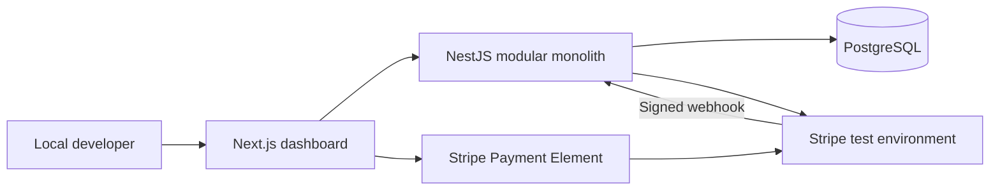

# Payment Processing Simulator

A test-mode payment application in development that demonstrates reliable backend engineering: payment lifecycles, Stripe integration, idempotent requests, database consistency, verified webhooks, and recovery from failures.

**Project status: Stage 1 complete and acceptance-verified.** The npm workspace, NestJS health API, Next.js shell, and PostgreSQL development/test environments now exist. Payment behavior, provider integration, dashboard workflows and CI remain planned for Stages 2–5. No deployed environment exists.

## Problem Statement

A payment request can time out after the provider has accepted it. Clients can retry concurrently, and webhooks can arrive repeatedly or in a different order. Treating each request as a new payment or each event as the latest truth can create duplicates and misleading results. This project will make these cases observable in a small application that one developer can build and explain.

## Primary Goals

- Build a modular NestJS backend with explicit transaction and provider boundaries.
- Prevent duplicate local payments and duplicate provider creation operations.
- Synchronize a local projection with Stripe's authoritative payment status.
- Demonstrate concurrency, signed webhook redelivery, transient failures, and recovery.
- Verify deterministic behavior without requiring Stripe credentials in ordinary tests.

## Key Features

The MVP will provide payment creation in integer minor units, a paginated payment list, details and an event timeline, a Stripe test payment form, and guarded development scenario controls. Supported currencies will initially be USD and EUR. Amounts will be integers from 100 through 1,000,000 minor units.

The scenario controls will demonstrate successful and declined test payments, identical requests, concurrent requests with one idempotency key, duplicate signed webhooks, a failed transaction, and recovery. Card details will be entered only into Stripe's Payment Element. The application will never receive or store raw card data.

## Technology Stack

| Area | Selected approach |
| --- | --- |
| Backend | Node.js, TypeScript, NestJS with Express, REST, OpenAPI / Swagger |
| Persistence | PostgreSQL and Prisma ORM |
| Provider | Stripe SDK, Payment Intents, Stripe.js / Payment Element; test mode only |
| Frontend | Next.js App Router, TypeScript, Tailwind CSS, shadcn/ui; Axios and TanStack Query for browser API calls/hooks |
| Workspace | npm workspaces; `apps/api` and `apps/web`; one lockfile |
| Infrastructure | Backend and PostgreSQL in Docker Compose from Stage 1; environment configuration; Redis only when a concrete feature needs it |
| Testing | Jest for unit/integration tests, Supertest for API tests, Playwright for browser tests |
| CI | GitHub Actions with a PostgreSQL service and credential-free deterministic tests |

Stage 1 pins stable package versions in the manifests and the single root lockfile. The Stripe SDK and an explicit stable Stripe API version will be recorded together in Stage 3. Version-specific official documentation takes precedence over old examples and optional skills.

## Selected Versions and Compatibility

| Component | Exact selected/resolved version | Runtime/compatibility decision |
| --- | --- | --- |
| Node.js | 24.22.3 in `.nvmrc` and API image; host checks also exercised on 24.16.0 | Supported Node 24 LTS, repository floor 24.11, below 25 |
| npm | 11.13.0 | Workspace package manager and API image; one root lockfile |
| NestJS / Express adapter | 12.5.1 | ESM application, constructor DI; Nest CLI 12.0.13 |
| Next.js | 16.4.6 | App Router under `apps/web/src/app`, native server-only health proxy |
| React / React DOM | 19.3.1 | Within Next.js peer requirements |
| TypeScript | 5.9.3 | Strict; API NodeNext, frontend bundler resolution |
| Prisma CLI / Client / PostgreSQL adapter | 7.10.1 | `prisma-client` generator, explicit ESM output; `@prisma/adapter-pg` with `pg` 8.16.3 |
| PostgreSQL | 17.9 | `postgres:17.9-bookworm`, named development volume, separate ephemeral test service |
| Jest / ts-jest / Supertest | 30.5.2 / 29.4.15 / 7.2.2 | One unit/API runner; Jest ESM uses Node's experimental VM-module flag |
| Tailwind CSS / PostCSS plugin | 4.3.5 | Supplied CSS variables and `@theme` exports imported directly |
| shadcn primitives / Base UI | Button and Badge / `@base-ui/react` 1.9.0 | Official base-nova source adapted to the supplied theme and folder entry points |
| UI class helpers | CVA 0.7.1, clsx 2.1.1, tailwind-merge 3.7.0 | Shared `cn()` recognizes the reference's custom typography roles |
| ESLint / TypeScript ESLint / Prettier | 10.15.0 / 8.73.0 / 3.10.1 | Flat config, Next core web vitals plugin 16.4.6 |
| Docker / Compose verification environment | CLI 29.9.3, engine 29.5.3 / Compose 5.1.4 | Compose 2.32+ required for Watch `initial_sync` |

Prisma 8 is a release candidate, so this stable setup explicitly stays on supported Prisma 7 ([release status](https://www.prisma.io/docs/orm/release-status)). Use the [version 7 client guidance](https://www.prisma.io/docs/orm/v7/prisma-client/setup-and-configuration/generating-prisma-client); do not run an unpinned Prisma CLI or skills sync. The generated client is ignored and recreated with `npm run db:generate`. There are no domain models or migrations yet. Database connections are lazy so liveness remains available during an outage; readiness uses `SELECT 1`, with one-second connection, query and statement timeouts, and no domain-table dependency.

## High-Level Architecture



Payments, provider integration, and webhook processing will be modules in one API process. PostgreSQL will hold the payment projection, immutable creation responses, audit events, and webhook processing records. External HTTP calls will run outside database transactions. Recovery will be driven by explicit requests and provider redelivery; the MVP will have no queue or background webhook worker.

See the [architecture index](docs/architecture/README.md) for the detailed design.

## Repository Structure

```text
payment-processing-simulator/
├── README.md
├── AGENTS.md                # Development context and agent instructions
├── .agents/skills/          # Installed project-local Codex skills
├── apps/
│   ├── api/                 # NestJS, Prisma schema/migrations, API tests
│   │   └── src/             # modules, shared, integrations, utils, constants
│   └── web/                 # Next.js dashboard and Playwright tests
│       └── src/             # app, components, api, types, utils, hooks
├── infra/                   # Compose and Docker configuration
├── docs/
│   ├── features/
│   │   ├── ROADMAP.md
│   │   └── stages/          # Five implementation instructions
│   ├── architecture/        # Domain, persistence, API and recovery contracts
│   └── design/              # Supplied visual reference and design tokens
├── package.json             # npm workspace definition
├── package-lock.json        # Pinned dependency graph
└── .github/workflows/        # Planned in Stage 5; not created yet
```

Stage 1 creates the two applications and infrastructure. The workflow directory remains planned. `skills.md` remains absent; no catalog or additional optional skills were installed during Stage 1.

The [source structure contract](docs/architecture/project-structure.md) defines DI boundaries, the backend's one-versus-many folder rule, provider adapters under `integrations`, page-local frontend components and API hooks, and component folders with `index.tsx` entry points. Both applications use a `src` directory. Only currently used infrastructure, health and shell folders are present.

## Local Codex Skills

All 14 unique skills recommended or listed as optional in the roadmap, plus `impeccable`, are installed under `.agents/skills`. The [installation manifest](.agents/skills/install-manifest.json) records upstream repositories, pinned commits and content hashes. Impeccable includes a local checksum-verified engine; installation did not enable hooks or initialize the application.

Skills remain optional development aids. The installed `prisma-client-api` describes the earlier Prisma Client API; it is not an authoritative Prisma 8 reference. Use version-matched Prisma guidance when selecting and implementing that stack.

## Design and Development Context

[AGENTS.md](AGENTS.md) defines the reading order for development tasks and requires the [design reference](docs/design/DESIGN.md) alongside the roadmap and architecture. Frontend setup, implementation and visual review must also use [structured tokens](docs/design/tokens.json), [CSS variables](docs/design/variables.css) and the [Tailwind theme](docs/design/theme.css).

These supplied files establish the dashboard's visual direction and shared token vocabulary. Adapt them to the payment workflows and accessibility requirements in the architecture; example marketing copy and reconstructed components do not add product features. Keep the source references intact and document application-specific token mappings or justified adaptations during implementation.

## Payment Lifecycle Overview

`CREATED` means a durable local payment exists. The confirmation-session request will create or recover exactly one Stripe PaymentIntent and normally move the payment to `PENDING`. A provider-confirmed decline maps to `FAILED`, which permits retrying the same intent with a new payment method. `SUCCEEDED` and `CANCELED` are terminal.

Status updates will come only from validated provider observations through the synchronization service. A browser callback, timeout, simulation request, or old webhook payload cannot directly set a payment status. See the complete [transition table and sequences](docs/architecture/payment-lifecycle.md).

## Local Development

Prerequisites: a supported Node 24 LTS release (the exact container/reference release is in `.nvmrc`), npm 11, Git, Docker and Compose 2.32+. Keep ports 3000, 3001, 5432 and the test-only 5433 free. API and database host publishing binds to `127.0.0.1`; Next.js also binds to loopback. Stripe credentials and global CLI installations are unnecessary for Stage 1.

From a clean checkout:

```bash
npm ci
npm run setup:env
npm run db:generate
npm run infra:check
npm run dev
```

In another terminal:

```bash
npm run dev:web
```

Open [the frontend shell](http://localhost:3000). Its server reads the API's published loopback port and links to an allowlisted, same-origin readiness proxy. The shell is dynamic and reports actual process/database observations; it does not process payments. The API endpoints are [liveness](http://localhost:3001/api/v1/health/live) and [readiness](http://localhost:3001/api/v1/health/ready).

`setup:env` creates ignored `.env`, `apps/api/.env`, `apps/api/.env.test` and `apps/web/.env.local` from committed placeholder examples, using a generated URL-safe random password and stable instance UUID. It refuses to overwrite existing files. Keep the instance UUID across normal restarts. For manual configuration, copy the corresponding examples and replace every placeholder; keep the root/API/test passwords consistent. These local files are excluded from Docker's build context.

The API runs inside Docker and connects to `db:5432`. Host Prisma tools use `127.0.0.1:5432`; integration tests use the distinct `simulator_test` database on `127.0.0.1:5433`. `API_INTERNAL_ORIGIN` and `WEB_ORIGIN` are server-only Next.js settings; the proxy rejects untrusted Host/Origin values and allows only the two health GET routes. Provider calls and simulations are disabled before Stage 3.

Compose waits for database health before starting the API. `npm run dev` enables Watch: source changes sync without replacing container dependencies; manifest, lockfile, Prisma, TypeScript and Docker configuration changes rebuild the image and run `npm ci` again. `npm run infra:up` starts/rebuilds the same services in the background without Watch. `npm run infra:down` stops/removes development containers while preserving the named database volume. Do not add `--volumes` when stopping normal development.

The API development image runs as the Node user with init/signal forwarding, OpenSSL for Prisma tooling, and pinned Node/npm versions. Nest CLI runs with `--no-shell` so source reloads stop the application process directly. Stage 5 owns production image hardening and the frontend container. Redis is omitted because no current feature requires it.

## Quality Checks and Test Database

```bash
npm run db:validate
npm run format:check
npm run lint
npm run typecheck
npm test
npm run build
```

For real-PostgreSQL health tests, start the isolated test service first:

```bash
docker compose --env-file .env -f infra/compose.test.yaml up -d --wait
npm run test:integration
docker compose --env-file .env -f infra/compose.test.yaml down
```

The test service uses tmpfs, not the development volume. The integration suite refuses a non-test database, non-loopback host or port other than 5433. It verifies readiness before domain migrations and the bounded unreachable-database response. Unit/API tests cover configuration validation, HTTP schemas/headers, query/body rejection, outages and safe error handling. Jest's VM-module warning is expected for the ESM runner.

The dependency audit during the shell's shadcn/Tailwind refactor reported zero vulnerabilities. Existing dependency versions were preserved while adding the UI primitives' dependencies; no automatic major downgrade or unverified dependency override was applied. Stage 5 will revisit the full dependency/security review.

## Design Integration

The web shell imports `docs/design/variables.css` and the Tailwind v4 `theme.css` without changing either supplied file. Global CSS contains those imports, semantic theme mappings and base element styles. Shell/page layout uses Tailwind utilities in JSX, and shared controls use shadcn Button/Badge with local variants. Component source lives in folder-based `index.tsx` files; `components.json` records the official Base UI/nova registry setup and source aliases. Dashboard workflows and additional primitives remain Stage 4 work.

The shell keeps the white canvas, navy text, small indigo actions, fine frost dividers, flat surfaces, 4px component radii and tabular numerals. Pills apply only to the test-mode tag. The documented fallback font stack is used without fetching fonts. Body text uses weight 400 and 1.5 line-height for operational readability; muted text maps to steel for contrast. Hovering a filled action uses the supplied deep violet instead of the lighter indigo-hover to retain white-text contrast. Input boundaries map to slate for a visible control edge; decorative dividers retain frost. There are no input controls yet. Responsive spacing comes from the supplied scale, with a 48px target for actions and stacked status rows on narrow screens. Dashboard components remain out of scope.

## Development Workflow

Follow the [five-stage roadmap](docs/features/ROADMAP.md) in order. Stage 1 passed its acceptance criteria on 2026-11-19 ([verification evidence](docs/features/stages/01-project-setup.md#verification-evidence--2026-11-19)); Stages 2–5 remain not started. Keep stages unchecked until required checks pass. Stage 2 adds the local domain, Stage 3 the provider/recovery boundary, Stage 4 dashboard workflows, and Stage 5 full runtime/CI hardening. Update contracts alongside implemented changes.

## Testing Strategy

Use Jest across backend unit and integration tests, avoiding a second unit-test runner. Supertest will exercise the actual NestJS HTTP pipeline. Integration tests will use real PostgreSQL with isolated test data; an in-memory database cannot prove uniqueness and transaction behavior.

Playwright will exercise the dashboard against a separately selected deterministic fake provider and test database. The fake will still emit signed webhook fixtures through the real verification endpoint. It is allowed only in development/test with explicit simulation enablement. A separate, opt-in Stripe test-mode smoke test will verify the actual SDK, Payment Element, and webhook forwarding. Ordinary CI will require no provider credentials and will never contact Stripe.

Health/configuration tests are established in Stage 1 and expand in every stage. Stage 5 adds the complete scenario matrix, restart/fencing checks, security review, Docker checks, and CI; it does not postpone foundational tests. See [Stage 5](docs/features/stages/05-testing-and-polish.md).

## Engineering Concepts Demonstrated

| Concept | Planned evidence |
| --- | --- |
| Payment integrations | One intent per local payment; secure collection through Stripe; explicit authoritative status mapping |
| Idempotency | A unique application key and frozen response, separate provider operation keys, separate webhook event IDs |
| Transaction consistency | Atomic local creation and atomic status/audit/webhook completion; rollback fault tests |
| Webhook processing | Raw-body verification, durable receipts, redelivery handling and current-state retrieval |
| Concurrent request handling | Database uniqueness for creation, fenced per-payment leases for synchronization |
| Failure recovery | Same-key provider retries within a safe window, explicit unknown outcomes and manual review after ambiguity |
| Backend architecture | A modular monolith, testable provider port, narrow services and consistent API contracts |

## Documentation Navigation

- [Agent instructions](AGENTS.md): required development context, design integration and verification rules.
- [Design reference](docs/design/DESIGN.md): visual direction, components and tokens, with [JSON tokens](docs/design/tokens.json), [CSS variables](docs/design/variables.css) and [Tailwind theme](docs/design/theme.css).
- [Implementation roadmap](docs/features/ROADMAP.md): scope, ordering, progress, and skill recommendations.
- [Architecture index](docs/architecture/README.md): contract ownership and reading order.
- [System overview](docs/architecture/system-overview.md): modules, runtime, configuration, and security.
- [Project structure](docs/architecture/project-structure.md): backend DI/integrations, frontend folders, component entry points and API hooks.
- [Database design](docs/architecture/database-design.md): entities, constraints, indexes, and transactions.
- [Payment lifecycle](docs/architecture/payment-lifecycle.md): status rules, confirmation, and recovery.
- [Idempotency and webhooks](docs/architecture/idempotency-and-webhooks.md): concurrency algorithms and failure sequences.
- [API design](docs/architecture/api-design.md): endpoint contracts and examples.

## Portfolio and Interview Relevance

The eventual demonstration should show database and provider evidence alongside the UI: ten concurrent creates producing one payment, a duplicate delivery producing no second business transition, and a successful provider payment recovered after an application timeout. Explain the boundary between a financial failure and a transport failure, the limits of idempotency retention, and why this small project needs neither microservices nor a distributed queue.

## Future Enhancements

Refunds, subscriptions, periodic reconciliation, BullMQ workers, background webhook processing, additional providers, observability dashboards, and AWS deployment are separate future work. None belongs to the initial five stages. Redis caching is also deferred by default, but Redis may be introduced during implementation if a concrete feature requires it; it must then run in Compose with a documented dependency and failure policy. Real-money payments, accounting ledgers, complex authentication, multi-tenancy, Kafka, Kubernetes, and microservices are outside the MVP.

