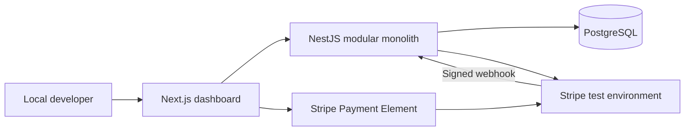

# Payment Processing Simulator

A planned, test-mode payment application that demonstrates reliable backend engineering: payment lifecycles, Stripe integration, idempotent requests, database consistency, verified webhooks, and recovery from failures.

**Project status: design complete; implementation has not started.** This repository contains documentation and project-local Codex skills. Application behavior, application/infrastructure files, and development workflows described below are planned. No application setup scripts, running services, screenshots, deployed URLs, or application test results exist yet.

## Problem Statement

A payment request can time out after the provider has accepted it. Clients can retry concurrently, and webhooks can arrive repeatedly or in a different order. Treating each request as a new payment or each event as the latest truth can create duplicates and misleading results. This project will make these cases observable in a small application that one developer can build and explain.

## Primary Goals

- Build a modular NestJS backend with explicit transaction and provider boundaries.
- Prevent duplicate local payments and duplicate provider creation operations.
- Synchronize a local projection with Stripe's authoritative payment status.
- Demonstrate concurrency, signed webhook redelivery, transient failures, and recovery.
- Verify deterministic behavior without requiring Stripe credentials in ordinary tests.

## Key Features

The MVP will provide payment creation in integer minor units, a paginated payment list, details and an event timeline, a Stripe test payment form, and guarded development scenario controls. Supported currencies will initially be USD and EUR. Amounts will be integers from 100 through 1,000,000 minor units.

The scenario controls will demonstrate successful and declined test payments, identical requests, concurrent requests with one idempotency key, duplicate signed webhooks, a failed transaction, and recovery. Card details will be entered only into Stripe's Payment Element. The application will never receive or store raw card data.

## Technology Stack

| Area | Selected approach |
| --- | --- |
| Backend | Node.js, TypeScript, NestJS with Express, REST, OpenAPI / Swagger |
| Persistence | PostgreSQL and Prisma ORM |
| Provider | Stripe SDK, Payment Intents, Stripe.js / Payment Element; test mode only |
| Frontend | Next.js App Router, TypeScript, Tailwind CSS, shadcn/ui; Axios and TanStack Query for browser API calls/hooks |
| Workspace | npm workspaces; `apps/api` and `apps/web`; one lockfile |
| Infrastructure | Backend and PostgreSQL in Docker Compose from Stage 1; environment configuration; Redis only when a concrete feature needs it |
| Testing | Jest for unit/integration tests, Supertest for API tests, Playwright for browser tests |
| CI | GitHub Actions with a PostgreSQL service and credential-free deterministic tests |

Stage 1 will select mutually supported stable package versions and pin them in the lockfile and a README version table. The Stripe SDK and an explicit stable Stripe API version will be recorded together in Stage 3. Version-specific official documentation takes precedence over old examples and optional skills.

## High-Level Architecture



Payments, provider integration, and webhook processing will be modules in one API process. PostgreSQL will hold the payment projection, immutable creation responses, audit events, and webhook processing records. External HTTP calls will run outside database transactions. Recovery will be driven by explicit requests and provider redelivery; the MVP will have no queue or background webhook worker.

See the [architecture index](docs/architecture/README.md) for the detailed design.

## Planned Repository Structure

```text
payment-processing-simulator/
├── README.md
├── AGENTS.md                # Development context and agent instructions
├── .agents/skills/          # Installed project-local Codex skills
├── apps/
│   ├── api/                 # NestJS, Prisma schema/migrations, API tests
│   │   └── src/             # modules, shared, integrations, utils, constants
│   └── web/                 # Next.js dashboard and Playwright tests
│       └── src/             # app, components, api, types, utils, hooks
├── infra/                   # Compose and Docker configuration
├── docs/
│   ├── features/
│   │   ├── ROADMAP.md
│   │   └── stages/          # Five implementation instructions
│   ├── architecture/        # Domain, persistence, API and recovery contracts
│   └── design/              # Supplied visual reference and design tokens
├── package.json             # Future npm workspace definition
├── package-lock.json        # Future pinned dependency graph
└── .github/workflows/        # Future CI
```

Only `README.md` and the `docs/` documents in this tree were created by the design task. The developer subsequently requested installation of the recommended and optional skills. `skills.md` remains absent; no catalog was created.

The [source structure contract](docs/architecture/project-structure.md) defines DI boundaries, the backend's one-versus-many folder rule, provider adapters under `integrations`, page-local frontend components and API hooks, and component folders with `index.tsx` entry points. Both applications use a `src` directory; these source folders remain planned until implementation.

## Local Codex Skills

All 14 unique skills recommended or listed as optional in the roadmap, plus `impeccable`, are installed under `.agents/skills`. The [installation manifest](.agents/skills/install-manifest.json) records upstream repositories, pinned commits and content hashes. Impeccable includes a local checksum-verified engine; installation did not enable hooks or initialize the application.

Skills remain optional development aids. The installed `prisma-client-api` describes the earlier Prisma Client API; it is not an authoritative Prisma 8 reference. Use version-matched Prisma guidance when selecting and implementing that stack.

## Design and Development Context

[AGENTS.md](AGENTS.md) defines the reading order for development tasks and requires the [design reference](docs/design/DESIGN.md) alongside the roadmap and architecture. Frontend setup, implementation and visual review must also use [structured tokens](docs/design/tokens.json), [CSS variables](docs/design/variables.css) and the [Tailwind theme](docs/design/theme.css).

These supplied files establish the dashboard's visual direction and shared token vocabulary. Adapt them to the payment workflows and accessibility requirements in the architecture; example marketing copy and reconstructed components do not add product features. Keep the source references intact and document application-specific token mappings or justified adaptations during implementation.

## Payment Lifecycle Overview

`CREATED` means a durable local payment exists. The confirmation-session request will create or recover exactly one Stripe PaymentIntent and normally move the payment to `PENDING`. A provider-confirmed decline maps to `FAILED`, which permits retrying the same intent with a new payment method. `SUCCEEDED` and `CANCELED` are terminal.

Status updates will come only from validated provider observations through the synchronization service. A browser callback, timeout, simulation request, or old webhook payload cannot directly set a payment status. See the complete [transition table and sequences](docs/architecture/payment-lifecycle.md).

## Local Development Prerequisites

Future implementation requires Git, a supported Node.js LTS release with npm, Docker with Compose, and available local ports for the web app (3000), API (3001), and PostgreSQL (5432). Docker-published ports must bind to `127.0.0.1`. A Stripe test account or sandbox and Stripe CLI are required only for the separate provider smoke test and interview demonstration.

The default local backend environment will include separate `api` (NestJS) and `db` (PostgreSQL) Compose services from Stage 1, with source synchronization, health checks and persistent database storage. Next.js may run on the host during development; Stage 5 adds its container and verifies the full stack's runtime images. Redis is not a baseline dependency; if a concrete feature requires it, add a `redis` Compose service and document its purpose. See the [container runtime contract](docs/architecture/system-overview.md#local-container-runtime).

No commands are offered as runnable project commands yet. Stage 1 must add and verify the real setup, migration, development, and test commands before documenting them here. No global tools or optional Codex skills need to be installed to follow the roadmap.

## Planned Development Workflow

Follow the [five-stage roadmap](docs/features/ROADMAP.md) in order. Each stage defines its prerequisites, concrete tasks, expected artifacts, tests, and completion conditions. Keep a stage unchecked until functionality and its acceptance criteria have been verified.

Stage 1 will establish environment examples, startup validation and the containerized backend/PostgreSQL development environment. Stage 2 will build the local domain without Stripe calls. Stage 3 will add the provider boundary and recovery rules. Stage 4 will expose these flows through the dashboard. Stage 5 will harden runtime images, add the frontend container and verify the complete application. Update contracts alongside each implemented change.

## Testing Strategy

Use Jest across backend unit and integration tests, avoiding a second unit-test runner. Supertest will exercise the actual NestJS HTTP pipeline. Integration tests will use real PostgreSQL with isolated test data; an in-memory database cannot prove uniqueness and transaction behavior.

Playwright will exercise the dashboard against a separately selected deterministic fake provider and test database. The fake will still emit signed webhook fixtures through the real verification endpoint. It is allowed only in development/test with explicit simulation enablement. A separate, opt-in Stripe test-mode smoke test will verify the actual SDK, Payment Element, and webhook forwarding. Ordinary CI will require no provider credentials and will never contact Stripe.

Tests start in Stage 1 and expand in every stage. Stage 5 adds the complete scenario matrix, restart/fencing checks, security review, Docker checks, and CI; it does not postpone foundational tests. See [Stage 5](docs/features/stages/05-testing-and-polish.md).

## Engineering Concepts Demonstrated

| Concept | Planned evidence |
| --- | --- |
| Payment integrations | One intent per local payment; secure collection through Stripe; explicit authoritative status mapping |
| Idempotency | A unique application key and frozen response, separate provider operation keys, separate webhook event IDs |
| Transaction consistency | Atomic local creation and atomic status/audit/webhook completion; rollback fault tests |
| Webhook processing | Raw-body verification, durable receipts, redelivery handling and current-state retrieval |
| Concurrent request handling | Database uniqueness for creation, fenced per-payment leases for synchronization |
| Failure recovery | Same-key provider retries within a safe window, explicit unknown outcomes and manual review after ambiguity |
| Backend architecture | A modular monolith, testable provider port, narrow services and consistent API contracts |

## Documentation Navigation

- [Agent instructions](AGENTS.md): required development context, design integration and verification rules.
- [Design reference](docs/design/DESIGN.md): visual direction, components and tokens, with [JSON tokens](docs/design/tokens.json), [CSS variables](docs/design/variables.css) and [Tailwind theme](docs/design/theme.css).
- [Implementation roadmap](docs/features/ROADMAP.md): scope, ordering, progress, and skill recommendations.
- [Architecture index](docs/architecture/README.md): contract ownership and reading order.
- [System overview](docs/architecture/system-overview.md): modules, runtime, configuration, and security.
- [Project structure](docs/architecture/project-structure.md): backend DI/integrations, frontend folders, component entry points and API hooks.
- [Database design](docs/architecture/database-design.md): entities, constraints, indexes, and transactions.
- [Payment lifecycle](docs/architecture/payment-lifecycle.md): status rules, confirmation, and recovery.
- [Idempotency and webhooks](docs/architecture/idempotency-and-webhooks.md): concurrency algorithms and failure sequences.
- [API design](docs/architecture/api-design.md): endpoint contracts and examples.

## Portfolio and Interview Relevance

The eventual demonstration should show database and provider evidence alongside the UI: ten concurrent creates producing one payment, a duplicate delivery producing no second business transition, and a successful provider payment recovered after an application timeout. Explain the boundary between a financial failure and a transport failure, the limits of idempotency retention, and why this small project needs neither microservices nor a distributed queue.

## Future Enhancements

Refunds, subscriptions, periodic reconciliation, BullMQ workers, background webhook processing, additional providers, observability dashboards, and AWS deployment are separate future work. None belongs to the initial five stages. Redis caching is also deferred by default, but Redis may be introduced during implementation if a concrete feature requires it; it must then run in Compose with a documented dependency and failure policy. Real-money payments, accounting ledgers, complex authentication, multi-tenancy, Kafka, Kubernetes, and microservices are outside the MVP.

