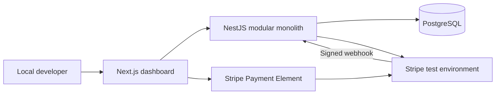

# Payment Processing Simulator

A test-mode payment application in development that demonstrates reliable backend engineering: payment lifecycles, Stripe integration, idempotent requests, database consistency, verified webhooks, and recovery from failures.

**Project status: Stages 1–4 complete with deterministic acceptance verified. The developer explicitly deferred real Stripe smoke and manual Payment Element verification to Stage 5 until test credentials are available. Actual Stripe behavior is not yet fully verified.** The dashboard now supports exact-money creation, paginated payments, details/history, retryable declines, confirmation sessions, signed-event replay, request races and one-shot failure/recovery demonstrations. Stage 5 CI/runtime hardening is not started. No deployed environment exists.

## Problem Statement

A payment request can time out after the provider has accepted it. Clients can retry concurrently, and webhooks can arrive repeatedly or in a different order. Treating each request as a new payment or each event as the latest truth can create duplicates and misleading results. This project will make these cases observable in a small application that one developer can build and explain.

## Primary Goals

- Build a modular NestJS backend with explicit transaction and provider boundaries.
- Prevent duplicate local payments and duplicate provider creation operations.
- Synchronize a local projection with Stripe's authoritative payment status.
- Demonstrate concurrency, signed webhook redelivery, transient failures, and recovery.
- Verify deterministic behavior without requiring Stripe credentials in ordinary tests.

## Key Features

The MVP will provide payment creation in integer minor units, a paginated payment list, details and an event timeline, a Stripe test payment form, and guarded development scenario controls. Supported currencies will initially be USD and EUR. Amounts will be integers from 100 through 1,000,000 minor units.

The scenario controls will demonstrate successful and declined test payments, identical requests, concurrent requests with one idempotency key, duplicate signed webhooks, a failed transaction, and recovery. Card details will be entered only into Stripe's Payment Element. The application will never receive or store raw card data.

## Technology Stack

| Area | Selected approach |
| --- | --- |
| Backend | Node.js, TypeScript, NestJS with Express, REST, OpenAPI / Swagger |
| Persistence | PostgreSQL and Prisma ORM |
| Provider | Stripe SDK, Payment Intents, Stripe.js / Payment Element; test mode only |
| Frontend | Next.js App Router, TypeScript, Tailwind CSS, shadcn/ui; Axios and TanStack Query for browser API calls/hooks |
| Workspace | npm workspaces; `apps/api` and `apps/web`; one lockfile |
| Infrastructure | Backend and PostgreSQL in Docker Compose from Stage 1; environment configuration; Redis only when a concrete feature needs it |
| Testing | Jest for unit/integration tests, Supertest for API tests, Playwright for browser tests |
| CI | GitHub Actions with a PostgreSQL service and credential-free deterministic tests |

Stage 1 pins stable package versions in the manifests and the single root lockfile. Stage 3 pins Stripe SDK 23.2.0 and stable request/snapshot API 2026-11-18.endive together. Version-specific official documentation takes precedence over old examples and optional skills.

## Selected Versions and Compatibility

| Component | Exact selected/resolved version | Runtime/compatibility decision |
| --- | --- | --- |
| Node.js | 24.22.3 in `.nvmrc` and API image; host checks also exercised on 24.16.0 | Supported Node 24 LTS, repository floor 24.11, below 25 |
| npm | 11.13.0 | Workspace package manager and API image; one root lockfile |
| NestJS / Express adapter | 12.5.1 | ESM application, constructor DI; Nest CLI 12.0.13 |
| Next.js | 16.4.6 | App Router under `apps/web/src/app`, native server-only health proxy |
| React / React DOM | 19.3.1 | Within Next.js peer requirements |
| TypeScript | 5.9.3 | Strict; API NodeNext, frontend bundler resolution |
| Prisma CLI / Client / PostgreSQL adapter | 7.10.1 | `prisma-client` generator, explicit ESM output; `@prisma/adapter-pg` with `pg` 8.16.3 |
| Stripe SDK / request and snapshot API | 23.2.0 / 2026-11-18.endive | Node 24-compatible SDK/types; card-only automatic confirmation/capture; five-second timeout, zero implicit retries |
| PostgreSQL | 17.9 | `postgres:17.9-bookworm`, named development volume, separate ephemeral test service |
| Jest / ts-jest / Supertest | 30.5.2 / 29.4.15 / 7.2.2 | One unit/API runner; Jest ESM uses Node's experimental VM-module flag |
| Swagger / Express | 12.1.2 / 5.3.0 | Nest 12-compatible DTO documentation; explicitly declared Express for bounded JSON parsing |
| Tailwind CSS / PostCSS plugin | 4.3.5 | Supplied CSS variables and `@theme` exports imported directly |
| shadcn primitives / Base UI | Button, Badge, Input, NativeSelect, Field, Table and feedback primitives / `@base-ui/react` 1.9.0 | Official base-nova source adapted to the supplied theme and folder entry points |
| Browser API / query state | Axios 1.21.1 / TanStack React Query 5.108.1 | Typed same-origin requests; no automatic retries or persistent query cache |
| Stripe browser libraries | React Stripe.js 7.1.0 / Stripe.js 10.3.0 | Lazy Payment Element; fake mode never loads Stripe.js |
| Browser tests / icons | Playwright 1.65.1 / Lucide React 0.577.0 | Real API/PostgreSQL and signed fake fixtures; consistent line icons |
| UI class helpers | CVA 0.7.1, clsx 2.1.1, tailwind-merge 3.7.0 | Shared `cn()` recognizes the reference's custom typography roles |
| ESLint / TypeScript ESLint / Prettier | 10.15.0 / 8.73.0 / 3.10.1 | Flat config, Next core web vitals plugin 16.4.6 |
| Docker / Compose verification environment | CLI 29.9.3, engine 29.5.3 / Compose 5.1.4 | Compose 2.32+ required for Watch `initial_sync` |

Prisma 8 is a release candidate, so this stable setup explicitly stays on supported Prisma 7 ([release status](https://www.prisma.io/docs/orm/release-status)). Use the [version 7 client guidance](https://www.prisma.io/docs/orm/v7/prisma-client/setup-and-configuration/generating-prisma-client); do not run an unpinned Prisma CLI or skills sync. The generated client is ignored and recreated with `npm run db:generate`. Stage 2 adds `20261119000100_payment_core`; Stage 3 adds the forward `20261119000200_stripe_integration` migration for provider fields, leases and sanitized webhook receipts. Database connections remain lazy in the application so liveness remains available during an outage; readiness uses `SELECT 1`, with one-second connection, query and statement timeouts, and no domain-table dependency. Development startup applies pending migrations before launching Nest.

## High-Level Architecture



Payments, provider integration and Webhooks run in one API process. PostgreSQL holds the payment projection, immutable creation responses, audit events and webhook receipts. External HTTP calls run outside database transactions. Recovery uses explicit requests and provider redelivery; the MVP has no queue or background webhook worker.

See the [architecture index](docs/architecture/README.md) for the detailed design.

## Repository Structure

```text
payment-processing-simulator/
├── README.md
├── AGENTS.md                # Development context and agent instructions
├── .agents/skills/          # Installed project-local Codex skills
├── apps/
│   ├── api/                 # NestJS, Prisma schema/migrations, API tests
│   │   └── src/             # modules, shared, integrations, utils, constants
│   └── web/                 # Next.js dashboard and Playwright tests
│       └── src/             # app, components, api, types, utils, hooks
├── infra/                   # Compose and Docker configuration
├── docs/
│   ├── features/
│   │   ├── ROADMAP.md
│   │   └── stages/          # Five implementation instructions
│   ├── architecture/        # Domain, persistence, API and recovery contracts
│   └── design/              # Supplied visual reference and design tokens
├── package.json             # npm workspace definition
├── package-lock.json        # Pinned dependency graph
└── .github/workflows/        # Planned in Stage 5; not created yet
```

Stage 1 creates the two applications and infrastructure; Stage 2 adds `modules/payments`, shared HTTP/error handling and the first domain migration. The workflow directory remains planned. `skills.md` remains absent; no catalog or additional optional skills were installed during Stages 1–4.

The [source structure contract](docs/architecture/project-structure.md) defines DI boundaries, the backend's one-versus-many folder rule, provider adapters under `integrations`, page-local frontend components and API hooks, and component folders with `index.tsx` entry points. Both applications use a `src` directory. Payments has one root controller, feature services under `services/`, DTOs and pure state/validation helpers; Stage 3 adds provider-neutral bindings, Stripe/fake integrations, lease/sync services and the Webhooks module.

## Local Codex Skills

All 14 unique skills recommended or listed as optional in the roadmap, plus `impeccable`, are installed under `.agents/skills`. The [installation manifest](.agents/skills/install-manifest.json) records upstream repositories, pinned commits and content hashes. Impeccable includes a local checksum-verified engine; installation did not enable hooks or initialize the application.

Skills remain optional development aids. The installed `prisma-client-api` describes the earlier Prisma Client API; it is not an authoritative Prisma 8 reference. Use version-matched Prisma guidance when selecting and implementing that stack.

## Design and Development Context

[AGENTS.md](AGENTS.md) defines the reading order for development tasks and requires the [design reference](docs/design/DESIGN.md) alongside the roadmap and architecture. Frontend setup, implementation and visual review must also use [structured tokens](docs/design/tokens.json), [CSS variables](docs/design/variables.css) and the [Tailwind theme](docs/design/theme.css).

These supplied files establish the dashboard's visual direction and shared token vocabulary. Adapt them to the payment workflows and accessibility requirements in the architecture; example marketing copy and reconstructed components do not add product features. Keep the source references intact and document application-specific token mappings or justified adaptations during implementation.

## Payment Lifecycle Overview

`CREATED` means a durable local payment exists. The confirmation-session request creates or recovers exactly one Stripe PaymentIntent and normally move the payment to `PENDING`. A provider-confirmed decline maps to `FAILED`, which permits retrying the same intent with a new payment method. `SUCCEEDED` and `CANCELED` are terminal.

Provider-driven status updates come only from validated provider observations through the synchronization service. A browser callback, timeout, simulation request, or old webhook payload cannot directly set a payment status. See the complete [transition table and sequences](docs/architecture/payment-lifecycle.md).

## Local Development

Prerequisites: a supported Node 24 LTS release (the exact container/reference release is in `.nvmrc`), npm 11, Git, Docker and Compose 2.32+. Keep ports 3000, 3001, 5432 and the test-only 5433 and 3102 free. API and database host publishing binds to `127.0.0.1`; Next.js also binds to loopback. The default explicitly enabled fake environment needs no Stripe credentials or CLI; real Stripe smoke checks require a separately configured test environment.

From a clean checkout:

```bash
npm ci
npm run setup:env
npm run db:generate
npm run infra:check
npm run dev
```

In another terminal:

```bash
npm run dev:web
```

Open [the payment dashboard](http://localhost:3000/payments). The server proxies allowlisted payment/health requests to the fixed loopback API origin. The persistent indicator identifies fake or Stripe test mode. The API endpoints are [liveness](http://localhost:3001/api/v1/health/live) and [readiness](http://localhost:3001/api/v1/health/ready).

`setup:env` creates ignored `.env`, `apps/api/.env`, `apps/api/.env.test` and `apps/web/.env.local` from committed placeholder examples, using a generated URL-safe random password, stable instance UUID, and distinct random fake signing/bearer secrets. Clean setup uses `simulator_fake`; existing ignored files are preserved and need the Stage 3 provider settings added manually. It refuses to overwrite existing files. Keep the instance UUID across normal restarts. For manual configuration, copy the corresponding examples and replace every placeholder; keep the root/API/test passwords consistent. These local files are excluded from Docker's build context.

The API runs inside Docker and connects to `db:5432`. Host Prisma tools use `127.0.0.1:5432`; integration tests use the distinct `simulator_test` database on `127.0.0.1:5433`. `API_INTERNAL_ORIGIN` and `WEB_ORIGIN` are server-only Next.js settings; the proxy rejects untrusted Host/Origin values and allows only documented health/payment methods and paths. Development handlers inject the server-only simulation token after exact Host/Origin validation. Fake mode requires a separate database ending `_fake`/`_test`. Existing web environment files must add `PAYMENT_PROVIDER`, `SIMULATION_ENABLED` and the **same server-only** `SIMULATION_TOKEN` as the API; copy the names from `apps/web/.env.example`. Never use a `NEXT_PUBLIC_` token.

Compose waits for database health before starting the API. The API's development script runs `prisma migrate deploy` before Nest, applying pending reviewed migrations on both new and existing databases. `npm run db:migrate` applies the same migrations from the host using `apps/api/.env` when needed. Do not use `db push` to bypass SQL checks. `npm run dev` enables Watch: source changes sync without replacing container dependencies; manifest, lockfile, Prisma, TypeScript and Docker configuration changes rebuild the image and run `npm ci` again. `npm run infra:up` starts/rebuilds the same services in the background without Watch. `npm run infra:down` stops/removes development containers while preserving the named database volume. Do not add `--volumes` when stopping normal development.

The API development image runs as the Node user with init/signal forwarding, OpenSSL for Prisma tooling, and pinned Node/npm versions. Nest CLI runs with `--no-shell` so source reloads stop the application process directly. Stage 5 owns production image hardening and the frontend container. Redis is omitted because no current feature requires it.

## Quality Checks and Test Database

```bash
npm run db:validate
npm run format:check
npm run lint
npm run typecheck
npm test
npm run build
```

If this managed environment rejects Turbopack's worker socket, the dashboard can be verified with `npm run build --workspace @simulator/web -- --webpack`; the API build remains `npm run build --workspace @simulator/api`. The default build script is preserved. This environment limitation also occurred in Stage 1's follow-up verification.

For real-PostgreSQL acceptance tests, start the isolated test service first:

```bash
docker compose --env-file .env -f infra/compose.test.yaml up -d --wait
npm run test:integration
docker compose --env-file .env -f infra/compose.test.yaml down
```

The test service uses tmpfs, not the development volume. Both the runner and suites refuse a non-test database, non-loopback host or port other than 5433. The runner generates Prisma, deploys migrations, builds the API and runs all integration suites. Tests truncate only the guarded test database, and restart verification starts two successive compiled API processes on port 3102. The suite covers readiness/outages, concurrent HTTP through two independent Prisma pools, rollback at both core-write boundaries, status/audit atomicity, immutable snapshots, SQL constraints and cursor pagination. Unit/API tests cover every state pair, strict validation, canonical hashes, bounded conflict retries, safe errors/logs, throttling and local-only Swagger. Jest's VM-module warning is expected for the ESM runner.

The Stage 2 runtime-only audit (`npm audit --omit=dev`) reports zero vulnerabilities. The full audit currently reports 18 moderate development-tool findings propagated through the existing Jest/glob/minimatch dependency tree. Adding Swagger did not change those existing packages. No automatic major downgrade or unverified override was applied; Stage 5 retains the full dependency/security review.

## Local Payment API

With Compose running, open [Swagger](http://localhost:3001/api/docs) or its [OpenAPI JSON](http://localhost:3001/api/docs-json). Documentation is not registered in production. Create/list/detail/events still perform local database operations only. Confirmation-session, explicit sync and the signed webhook route are implemented. Stage 4 adds guarded simulation orchestration; the browser proxy exposes payment/session/sync/events and fixed development scenarios, never arbitrary webhook JSON or target URLs.

```bash
curl -i http://localhost:3001/api/v1/payments \
  -H 'Content-Type: application/json' \
  -H 'Idempotency-Key: stage2-example-payment-0001' \
  --data '{"amount":2500,"currency":"usd"}'
curl 'http://localhost:3001/api/v1/payments?status=CREATED&limit=20'
```

Creation returns 201, a `Location` header and `Idempotency-Replayed: false`. Repeat the same command to receive the identical body with `Idempotency-Replayed: true`; changing the amount or currency under that key returns 409 `IDEMPOTENCY_KEY_REUSED`. Use a new key for an intentional new payment. Read the returned `Location`, or append `/events` to it for audit history. See the [API contract](docs/architecture/api-design.md) for complete schemas and cursor rules.

Amounts must be JSON integers from 100 through 1,000,000 minor units. Currency is trimmed/uppercased to USD or EUR. Unknown fields, invalid/duplicate headers and malformed cursors return 400 without writes. JSON bodies are limited to 16 KiB; wrong media type returns 415, oversized bodies 413, and creation is limited to 120 requests per minute per IP in the local API process (429 with `Retry-After`). Unavailable persistence returns sanitized retryable 503 responses. Logs include only request IDs, route templates, status, duration, safe error codes and replay disposition.

Creation atomically commits one payment, immutable response record and version-1 audit event using PostgreSQL uniqueness. Status/audit changes are internal and transaction-aware; there is no status mutation endpoint. Local creation starts at `CREATED` / `NOT_STARTED` without contacting a provider. Confirmation-session, sync and verified webhooks can subsequently advance the current projection. Provider fields and webhook audit references are populated by those committed Stage 3 operations; creation retries still replay the original snapshot.

## Design Integration

The web shell imports `docs/design/variables.css` and the Tailwind v4 `theme.css` without changing either supplied file. Global CSS contains those imports, semantic theme mappings and base element styles. Shell/page layout uses Tailwind utilities in JSX, and shared controls use shadcn Button/Badge with local variants. Component source lives in folder-based `index.tsx` files; `components.json` records the official Base UI/nova registry setup and source aliases. Stage 4 adds normalized folder-based Input, NativeSelect, Field/Label, Table, Alert, Empty, Skeleton and Separator primitives. The CLI’s erroneous `cn` package import was replaced with the existing `@/utils/cn`; no duplicate flat primitives remain.

The shell keeps the white canvas, navy text, small indigo actions, fine frost dividers, flat surfaces, 4px component radii and tabular numerals. Pills apply to mode/status/version tags. The documented fallback font stack is used without fetching fonts. Body text uses weight 400 and 1.5 line-height for operational readability; muted text maps to steel for contrast. Hovering a filled action uses the supplied deep violet instead of the lighter indigo-hover to retain white-text contrast. Input boundaries map to slate for a visible control edge; decorative dividers retain frost. Inputs/selects retain 4px radii, 48px controls and visible keyboard focus. The 96px marketing section gap is adapted to 24/32/40/48px dashboard groups; 14px table/detail text retains tabular numerals. The ledger scrolls inside a named keyboard-focusable region at narrow widths; details stack and long IDs wrap. Status/error text and line icons convey meaning without extra status colors. Stripe Appearance variables are resolved from the same CSS roles at mount. Source exports remain unchanged.

## Development Workflow

Follow the [five-stage roadmap](docs/features/ROADMAP.md) in order. Stages 1 and 2 passed their acceptance criteria on 2026-11-19 ([setup evidence](docs/features/stages/01-project-setup.md#verification-evidence--2026-11-19), [Payment Core evidence](docs/features/stages/02-payment-core.md#verification-evidence--2026-11-19)); Stage 3 is complete and deterministically verified; the developer explicitly deferred real Stripe smoke execution to Stage 5 until credentials are available. Stage 4 is deterministically verified; real Payment Element verification is explicitly deferred to Stage 5. Stage 5 runtime/CI hardening remains not started. Update contracts alongside implemented changes.

## Testing Strategy

Use Jest across backend unit and integration tests, avoiding a second unit-test runner. Supertest exercises the actual NestJS HTTP pipeline. Integration tests use real PostgreSQL with isolated test data; an in-memory database cannot prove uniqueness and transaction behavior.

Playwright exercises the dashboard against a separately selected deterministic fake provider, real API and test database. The fake emits signed webhook fixtures through the real verification endpoint. It is allowed only in development/test with explicit simulation enablement. The separate Stage 3 opt-in Stripe smoke harness checks real success/decline and authentic webhook forwarding; its execution is outstanding. Stage 4 browser coverage verifies fake success/decline and recovery; manual hosted Payment Element checks remain deferred to Stage 5 by explicit developer approval. Ordinary CI will require no provider credentials and will never contact Stripe.

Health/configuration tests are established in Stage 1 and expand in every stage. Stage 5 adds the complete scenario matrix, restart/fencing checks, security review, Docker checks, and CI; it does not postpone foundational tests. See [Stage 5](docs/features/stages/05-testing-and-polish.md).

## Engineering Concepts Demonstrated

| Concept | Implemented or planned evidence |
| --- | --- |
| Payment integrations | One intent per local payment; secure collection through Stripe; explicit authoritative status mapping |
| Idempotency | A unique application key and frozen response, separate provider operation keys, separate webhook event IDs |
| Transaction consistency | Atomic local creation and atomic status/audit/webhook completion; rollback fault tests |
| Webhook processing | Raw-body verification, durable receipts, redelivery handling and current-state retrieval |
| Concurrent request handling | Database uniqueness for creation, fenced per-payment leases for synchronization |
| Failure recovery | Same-key provider retries within a safe window, explicit unknown outcomes and manual review after ambiguity |
| Backend architecture | A modular monolith, testable provider port, narrow services and consistent API contracts |

## Documentation Navigation

- [Agent instructions](AGENTS.md): required development context, design integration and verification rules.
- [Design reference](docs/design/DESIGN.md): visual direction, components and tokens, with [JSON tokens](docs/design/tokens.json), [CSS variables](docs/design/variables.css) and [Tailwind theme](docs/design/theme.css).
- [Implementation roadmap](docs/features/ROADMAP.md): scope, ordering, progress, and skill recommendations.
- [Architecture index](docs/architecture/README.md): contract ownership and reading order.
- [System overview](docs/architecture/system-overview.md): modules, runtime, configuration, and security.
- [Project structure](docs/architecture/project-structure.md): backend DI/integrations, frontend folders, component entry points and API hooks.
- [Database design](docs/architecture/database-design.md): entities, constraints, indexes, and transactions.
- [Payment lifecycle](docs/architecture/payment-lifecycle.md): status rules, confirmation, and recovery.
- [Idempotency and webhooks](docs/architecture/idempotency-and-webhooks.md): concurrency algorithms and failure sequences.
- [API design](docs/architecture/api-design.md): endpoint contracts and examples.

## Portfolio and Interview Relevance

The eventual demonstration should show database and provider evidence alongside the UI: ten concurrent creates producing one payment, a duplicate delivery producing no second business transition, and a successful provider payment recovered after an application timeout. Explain the boundary between a financial failure and a transport failure, the limits of idempotency retention, and why this small project needs neither microservices nor a distributed queue.

## Future Enhancements

Refunds, subscriptions, periodic reconciliation, BullMQ workers, background webhook processing, additional providers, observability dashboards, and AWS deployment are separate future work. None belongs to the initial five stages. Redis caching is also deferred by default, but Redis may be introduced during implementation if a concrete feature requires it; it must then run in Compose with a documented dependency and failure policy. Real-money payments, accounting ledgers, complex authentication, multi-tenancy, Kafka, Kubernetes, and microservices are outside the MVP.


## Stage 3 Provider Setup and Recovery

The API now selects `stripe` or the explicitly guarded deterministic `fake` through the neutral `PAYMENT_PROVIDER` token. Stripe-mode startup requires test-only keys, the expected account, `STRIPE_API_VERSION=2026-11-18.endive`, a matching snapshot webhook secret/version and the fixed `http://localhost:3000/payments/return` URL. It validates the current account before starting. Fake mode requires explicit simulation enablement, a separate `_fake`/`_test` database and a separate `whsec_fake_` secret. Production rejects fake/simulation configuration. Existing Stage 2 environment files are preserved; follow the [upgrade instructions](docs/features/stages/03-stripe-integration.md#local-setup-and-upgrade) before starting the updated API. Compose reads the API environment file and supplies its container-specific database URL.

`POST /api/v1/payments/:id/confirmation-session` and `POST /api/v1/payments/:id/sync` accept exactly `{}`. Sessions create/recover one intent with frozen parameters and expose the client secret only after linkage commits. Sync only retrieves known intents. `POST /api/v1/webhooks/stripe` verifies exact signed bytes, stores a sanitized receipt, retrieves current provider state, and commits payment/audit/receipt completion atomically. All paths use a 30-second database lease with token fencing. Unknown creates retain the same key, six-attempt budget and original 23-hour cutoff; expired/ambiguous operations stop for manual review.

The deterministic verification on 2026-11-19 passes **156 unit/API tests and 62 real-PostgreSQL integration tests** without external provider requests or Stripe credentials. Provider smoke is separately **SKIPPED / DEFERRED** until a configured test account and authentic webhook forwarding are available. The developer explicitly approved Stage 3 closure with this follow-up tracked in Stage 5; actual Stripe behavior is not claimed fully verified. The opt-in `STRIPE_SMOKE_ENABLED=true npm run test:stripe-smoke` harness checks real success/decline and processed authentic receipts. See the [Stage 3 evidence, smoke setup and operator recovery procedure](docs/features/stages/03-stripe-integration.md#verification-evidence--2026-11-19). No frontend payment UI or simulation endpoints were added.


## Stage 4 Dashboard Demo

Start Compose (`npm run infra:up`) and the web app (`npm run dev:web`), then open [Payments](http://localhost:3000/payments). If this environment blocks Turbopack worker sockets, use `npm run dev --workspace @simulator/web -- --webpack`. Open the exact browser origin configured by `WEB_ORIGIN`; Next.js displaying its `127.0.0.1` listening address does not change that setting. To use `http://127.0.0.1:3000`, set that exact `WEB_ORIGIN` in the root `.env`, `apps/api/.env` and `apps/web/.env.local`, and set `PAYMENT_RETURN_URL=http://127.0.0.1:3000/payments/return` in the API environment. Recreate the API container with `npm run infra:up` and restart the web process after changing settings. `localhost` and `127.0.0.1` are distinct browser origins; mismatched Host/Origin values intentionally return 403.

1. Create `27.31 EUR`. Inspect the exact amount, current status, provider linkage and newest-first audit timeline. Use the ledger status filter and Next/Previous controls to find payments.
2. In fake mode, open the confirmation session, choose **Confirm fake decline**, then **Confirm fake success**. The decline is retryable; the provider intent ID stays unchanged. Terminal success closes confirmation. Fake mode has no card fields and never loads Stripe.js.
3. Run **Run two identical requests** and **Race ten requests** on the ledger. Each starts a fresh $25.00 USD demonstration and reports every HTTP status/payment ID plus PostgreSQL payment/creation-event counts. Unexpected counts/statuses show failed assertions.
4. On a new pending payment, arm **webhook rollback**, then confirm fake success. Observe webhook HTTP 503, unchanged local financial status and retry timing. Copy the event ID from the delivery report/history, wait until eligible, then **Replay signed event twice**. Both deliveries must return 200, the receipt becomes PROCESSED, and the event has one financial transition. Replay again: delivery count rises; transition count remains one. Replaying an already processed event does not consume a rollback fault.
5. On a new local payment, arm **provider response timeout**, then open the session. Financial status stays CREATED; the operational result is RETRYABLE/PROVIDER_OUTCOME_UNKNOWN. After retry eligibility, **Recover confirmation session** reuses the frozen provider operation and links the original intent. For a linked payment, use **Synchronize with provider** to recover without creating or reconfirming anything.
6. If a create response is lost, use **Retry same request**. The form retains its original body/key in memory and locks edits until a definitive response. The replayed 201 is never treated as current status; the details query supplies it.

Faults are payment-scoped, one-shot, expire after 60 seconds and vanish on API restart. Fake provider objects/fixtures are process-local; use a new payment after deliberately restarting that external fake unless a test explicitly reseeds it. Production/disabled backend simulations are unregistered; the web proxy also returns 404 and hides controls. Stripe mode has no fake-confirm endpoint.

For deterministic browser acceptance:

```bash
docker compose --env-file .env -f infra/compose.test.yaml up -d --wait
npm run test:integration
npm run test:e2e
```

Run these suites **sequentially**: both intentionally use the guarded `_test` database; browser tests use ports 3000/3102. The E2E runner reads the ignored API test environment, migrates that database, starts its own real API and Next.js server, and stops both afterwards. It requires an installed Chromium (`npx playwright install chromium` on a fresh machine). It never uses the development database, real Stripe credentials or invented success responses. The lost-response fixture discards a real committed HTTP response. Traces are disabled to avoid recording session response secrets; responsive screenshots contain only rendered non-sensitive UI. `SIMULATOR_E2E=true` is server-only and reserves the fixed loopback port 3102; normal operation accepts port 3001 only.

Queries/mutations have zero automatic retries and no focus/reconnect refetches. Details poll every two seconds for at most 60 seconds, stopping on terminal status; explicit refresh restarts the window. Mutation invalidation refetches lists/details/history without optimistic financial states. Confirmation sessions bypass both query and mutation caches and remain component-local; Axios errors discard raw configuration/response references. No query persistence, card data storage or new domain tables were added.

In real Stripe mode, Payment Element confirms with the fixed origin’s `/payments/return` and `redirect: if_required`. A short-lived HttpOnly cookie contains only the local payment UUID for return correlation. The return handler ignores URL outcome claims, discards provider query values, clears the cookie and redirects to a clean detail URL for synchronization. Incoming Next.js URL logging is disabled and the return uses `no-referrer`/`no-store`. Stripe-controlled redirect behavior and hosted iframe interaction still require the separately deferred real-provider check; they are not asserted by the fake suite.

See [Stage 4 acceptance evidence](docs/features/stages/04-payment-simulator.md#verification-evidence--2026-11-19) for verified results and the [Stage 5 follow-up](docs/features/stages/05-testing-and-polish.md#deferred-real-provider-browser-verification).
