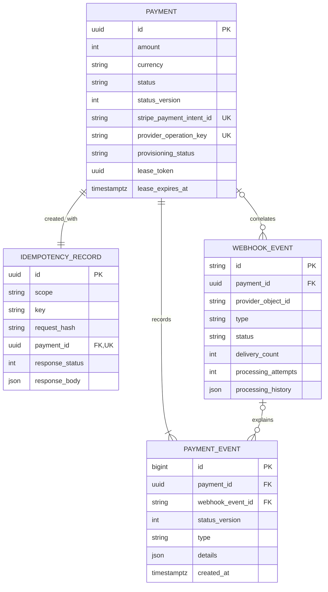

# Database Design

## Persistence Rules

Use PostgreSQL through Prisma. Model names are PascalCase; application/API fields use camelCase; physical table and column names use snake_case mappings. Store all times as UTC `timestamptz` with millisecond precision. Use database time for leases and retry deadlines. Use UUID primary keys except for provider event IDs and ordered audit IDs. Money is a PostgreSQL integer, never a float or decimal calculation in application code.

Four entities are sufficient. `Payment` is the current local projection, `IdempotencyRecord` preserves the create response, `PaymentEvent` provides application audit history, and `WebhookEvent` tracks verified provider deliveries. There is no `PaymentAttempt`: retries reuse the intent, and sanitized decline observations already belong in the audit history.

The diagram shows logical relationships. A payment has exactly one idempotency record and at least its creation event after the creation transaction commits. SQL foreign keys enforce child integrity; atomic creation enforces the reverse cardinality.

## Payment

| Field | Type / requirement |
| --- | --- |
| `id` | UUID primary key, generated before the creation transaction |
| `amount` | Integer; check constraint 100 through 1,000,000 |
| `currency` | Uppercase string; check constraint in `USD`, `EUR` |
| `status` | Enum: `CREATED`, `PENDING`, `FAILED`, `SUCCEEDED`, `CANCELED` |
| `statusVersion` | Integer, starts at 1; increments only on an actual financial status change |
| `stripePaymentIntentId` | Nullable unique string; immutable once linked |
| `providerStatus` | Nullable allowlisted Stripe status string from the last committed observation |
| `providerOperationKey` | Unique immutable string `pps:pi:create:v1:<payment UUID>` |
| `providerCreateParams` | Nullable JSON; exact non-sensitive create parameters frozen on first claim, including metadata and API version |
| `provisioningStatus` | Enum `NOT_STARTED`, `READY`, `RETRYABLE`, `BLOCKED`, `REVIEW_REQUIRED`; operational, separate from financial status |
| `firstProviderRequestAt` | Nullable timestamp written before the first outbound create attempt |
| `createAttemptCount` | Nonnegative integer, starts at 0; increment before each outbound create attempt |
| `nextProviderRetryAt` | Nullable timestamp; both confirmation-session and sync requests enforce it |
| `lastProviderErrorCode` | Nullable safe application error code, never an SDK exception dump |
| `leaseToken` / `leaseExpiresAt` | Nullable UUID/timestamp pair, both set or both null |
| `lastSyncedAt` | Nullable timestamp of a committed validated observation |
| `createdAt` / `updatedAt` | Required timestamps; `createdAt` immutable |

`READY` means a validated intent has been linked and the last provider operation succeeded, not that funds succeeded. A timeout during synchronization can mark a linked payment `RETRYABLE` without changing its financial status. `BLOCKED` indicates configuration/parameter failure; `REVIEW_REQUIRED` indicates ambiguity or an invariant violation that automated creation must not resolve.

Additional constraints: `statusVersion >= 1`, `createAttemptCount >= 0`, valid lease pair, and provider status allowlist. `stripePaymentIntentId` permits multiple nulls under PostgreSQL uniqueness. Never allow deletion or replacement of a linked intent ID. Application transitions and audit pairing are verified in integration tests; a SQL enum alone cannot enforce the state machine.

Indexes: primary key; unique intent ID; unique operation key; `(createdAt DESC, id DESC)` for cursor pagination; `(status, createdAt DESC, id DESC)` for filtered lists. No index on raw JSON is needed.

## IdempotencyRecord

| Field | Type / requirement |
| --- | --- |
| `id` | UUID primary key |
| `scope` | Constant `demo:create-payment:v1` |
| `key` | Case-sensitive ASCII key, 16–128 characters |
| `requestHash` | SHA-256 hex of the canonical validated request |
| `paymentId` | Unique, non-null FK to Payment; restrict deletion |
| `responseStatus` | Constant 201 for this MVP operation |
| `responseBody` | Immutable JSON creation representation, including `CREATED` and original `createdAt` |
| `createdAt` | Required timestamp |

Unique constraint `(scope, key)` is the concurrency authority. Keys are global to this single demo database, not scoped to an IP, browser session, or payment ID. No expiration or key recycling occurs during the MVP. A deliberate complete local database reset discards the namespace and all its guarantees together. Do not delete records while keeping their payments.

Store a response snapshot because the live Payment changes after creation. Replaying a request must not silently change its 201 body. No client secret, key, signature, or raw provider response is permitted in that snapshot. Validation errors and failed transactions create no record.

## PaymentEvent

| Field | Type / requirement |
| --- | --- |
| `id` | Database-generated `bigint` identity primary key; expose as a decimal string |
| `paymentId` | Non-null FK to Payment; restrict deletion |
| `webhookEventId` | Nullable FK to WebhookEvent; restrict deletion |
| `type` | Enum listed below |
| `fromStatus` / `toStatus` | Nullable Payment status; set for financial transition records |
| `statusVersion` | Nullable integer; set only for financial transitions |
| `details` | Allowlisted JSON: safe error code, normalized provider status, provider request ID, source |
| `createdAt` | Required timestamp |

Types: `PAYMENT_CREATED`, `PAYMENT_STATUS_CHANGED`, `PROVIDER_RETRY_SCHEDULED`, `PROVIDER_BLOCKED`, `REVIEW_REQUIRED`, `WEBHOOK_PROCESSING_FAILED`, and `SYNC_NO_CHANGE`. Initial creation has null `fromStatus`, `toStatus=CREATED`, and version 1. Every changed status gets exactly one `PAYMENT_STATUS_CHANGED` with the new version. Same-state observations do not create another financial transition; webhook processing history still records their disposition. An explicit no-change sync may add `SYNC_NO_CHANGE`.

Unique `(paymentId, statusVersion)` prevents duplicate financial transition records; PostgreSQL permits multiple null versions for operational events. Index `(paymentId, id DESC)` supports ordered event history; index the nullable `webhookEventId` FK. Payment events are append-only. Identity values can have gaps after rollback and are ordering/cursor values, not transaction counts.

There is no fulfillment, email, or ledger operation in the MVP. The auditable transition is the business effect. If a future side effect is added, this table is not a delivery queue; design a transactional outbox separately.

## WebhookEvent

| Field | Type / requirement |
| --- | --- |
| `id` | Stripe event ID primary key, e.g. `evt_...` |
| `type` / `apiVersion` / `providerCreatedAt` | Verified envelope metadata; timestamps are audit data, not ordering authority |
| `livemode` | Must be false; reject live-mode input before insertion |
| `providerObjectId` | Nullable PaymentIntent ID; no FK because the provider object can precede local linkage |
| `metadataPaymentId` / `metadataInstanceId` | Nullable allowlisted strings used only as correlation hints |
| `paymentId` | Nullable FK to Payment; restrict deletion |
| `status` | Enum `RECEIVED`, `RETRYABLE`, `PROCESSED`, `IGNORED`, `REVIEW_REQUIRED` |
| `deliveryCount` | Integer starts at 1; increment atomically for each verified redelivery |
| `processingAttempts` | Integer starts at 0; increment when a lease is acquired for processing |
| `firstReceivedAt` / `lastReceivedAt` | Required timestamps |
| `nextRetryAt` / `processedAt` | Nullable timestamps |
| `lastErrorCode` | Nullable sanitized error code |
| `processingHistory` | JSON array of `{at, outcome, code?}` appended under a row lock for each processing start/outcome; no raw payload |

Index `paymentId` and `(status, nextRetryAt)` for diagnosis/recovery queries. Only the event ID is unique. Do **not** make `(type, providerObjectId)` unique: separate failure events for one intent can be legitimate. Repeated semantic effects are prevented by the state machine and atomic transition versioning instead.

The durable sanitized envelope is enough to re-retrieve the intent after restart. Preserve provider event IDs indefinitely with the demo data. No complete webhook JSON or card details are stored. For uncorrelated events, `processingHistory` retains the audit even when there is no PaymentEvent. Verified deliveries whose event ID conflicts with the stored immutable identity/type/object metadata are rejected with 400 and a safe security log, rather than replacing the receipt.

## Transaction Boundaries

| Boundary | Writes that must commit together |
| --- | --- |
| T1: local create | Payment + IdempotencyRecord with response snapshot + initial PaymentEvent |
| T2: verified receipt | Insert WebhookEvent, or increment receipt count without overwriting its immutable identity |
| T3: claim | Conditionally claim Payment lease; freeze create parameters/deadline/count if creating; for a webhook, record processing start |
| T4: apply observation | Check token and expiry, link/validate intent, apply allowed status/version change, insert matching audit, update operational fields, release lease; for webhook processing, mark PROCESSED and append history in the same transaction |
| T5: failed processing | With valid ownership, store safe operational error/retry time, release lease, append failure history/audit; never invent a financial failure |

T2 is separate from T4 so a crash after receipt leaves recoverable evidence. Never return an actionable webhook's success response after T2 alone. T4 failure rolls back both the payment change and webhook completion; the receipt remains unprocessed for redelivery. When PostgreSQL is unavailable, even failure-recording may fail: return 503 and rely on redelivery, with a structured application log as best-effort evidence.

Use PostgreSQL `READ COMMITTED`, database uniqueness and short row locks. Acquire rows consistently in Payment-then-WebhookEvent order in transactions touching both. Receipt-only transactions touch WebhookEvent alone and finish before a claim begins. Prisma operations must use the selected version's transaction API; parameterized SQL is acceptable for row locking/conditional lease claims and constraints not represented by that version's schema tooling. Never concatenate caller input into SQL.

## Concurrency and Recovery Invariants

For concurrent creation, a losing unique-key insert rolls back its entire transaction, including the provisional Payment. Catch the specific uniqueness error outside the failed transaction; use a new read to retrieve the committed winner. A lock wait or transient database error may return 503; the client retries the same key.

All provider synchronization paths use the same Payment lease. Acquisition atomically succeeds only when no lease exists or its expiry has passed. Use a new random token for every claim. After HTTP completes, commit only when token matches and expiry is still in the future using database time. A stale owner must discard its observation and must not clear a newer owner's lease. A crashed owner becomes recoverable after 30 seconds; its unknown create can be retried only with the same provider key inside the safe window.

No lease holds a database transaction or connection open during HTTP. Constraints prevent duplicate rows; fencing prevents obsolete owners from applying retrieved snapshots. [Idempotency and webhooks](idempotency-and-webhooks.md) defines the complete algorithm and safe retry cutoff.

## Migration and Data Lifecycle

Stage 2 will create the first domain migration; Stage 3 will add provider/receipt fields and constraints. Add SQL checks/indexes in reviewed migrations when needed. Test migration application against empty PostgreSQL, FK restriction, concurrent insertion, null uniqueness, and rollback. Keep schema changes forward-oriented; do not edit applied migrations. Stage 1 establishes Prisma configuration and an empty generated client; there are no domain models or migrations yet.

