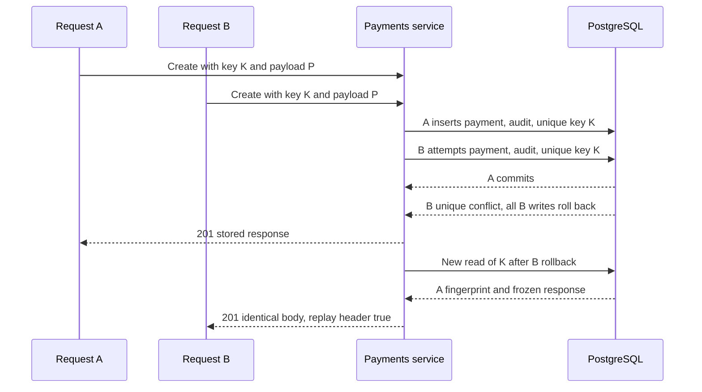
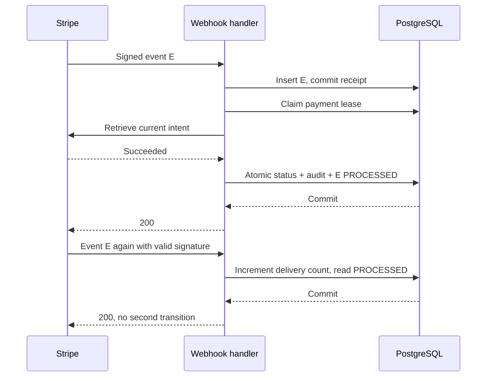
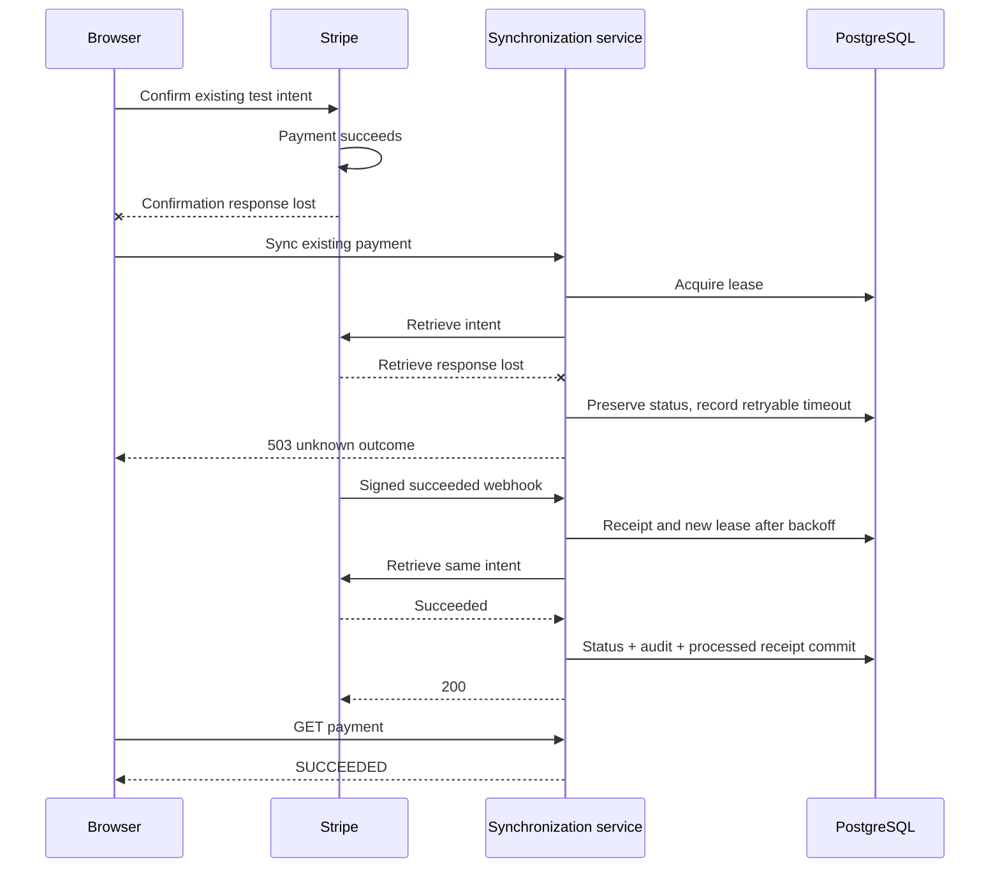
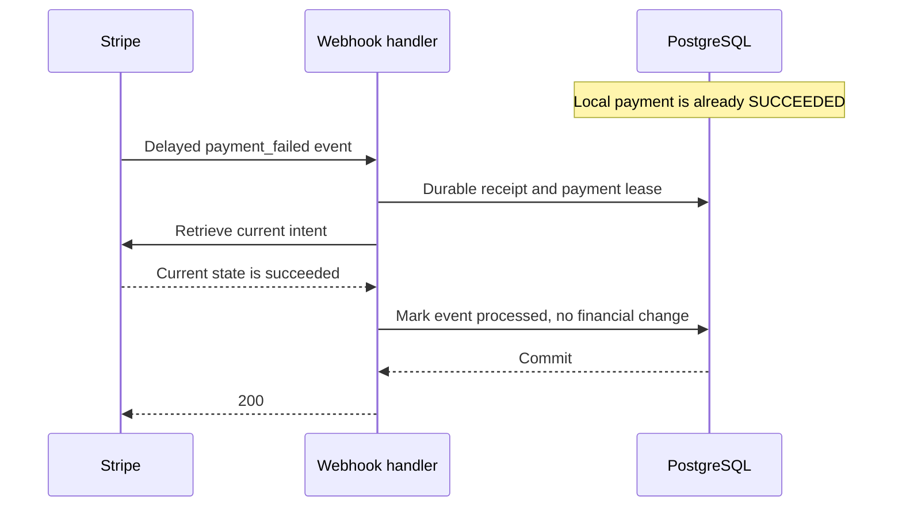

# Idempotency and Webhook Processing

## Three Independent Guarantees

| Layer | Identifier / scope | Guarantee |
| --- | --- | --- |
| Application creation | `(demo:create-payment:v1, Idempotency-Key)` in one database | One local payment and a frozen 201 response per canonical request |
| Stripe intent creation | `pps:pi:create:v1:<payment UUID>` in the configured Stripe test account | Repeating the same provider operation within its safe window does not deliberately create another intent |
| Webhook receipt | Stripe event ID | Repeated deliveries cannot reapply a committed business transition |

An application retry does not imply a new Stripe call. A Stripe retry does not imply a new local payment. A deduplicated event does not prove all other events for that intent are duplicates. No layer claims exactly-once HTTP delivery.

## API Idempotency

The frontend creates a random UUID for a logical create action. It retains that key and request until a definitive response arrives. A new intentional payment gets a new key; double-clicks and transport retries use the original one. Do not derive keys from amounts, timestamps, IPs, or sensitive information.

Accept a case-sensitive ASCII header value of 16–128 characters matching `[A-Za-z0-9._:-]+`. Do not trim or case-fold it. Reject a missing, duplicate, malformed, or oversized header with 400 before writes. Keys are globally scoped to the single demo's create operation, not to a user or provider account supplied by the caller. Retain keys for the lifetime of the database, without a TTL.

Validate and reject unknown request fields before hashing. Normalize currency by trimming and uppercasing; validate amount as a JSON integer in the documented range without coercing strings. Canonical bytes are UTF-8 JSON with exactly these keys in this order and no whitespace: `{"amount":2500,"currency":"USD"}`. Compute a SHA-256 hex fingerprint. A changed field order or equivalent currency spelling does not conflict; a changed amount or currency does.

### Creation Algorithm

1. Validate headers/body and compute canonical hash.
2. Optionally read an existing record for a fast replay; correctness does not depend on this read.
3. In T1, insert Payment in `CREATED`, its PaymentEvent at version 1, and IdempotencyRecord with the exact creation response and status 201. No provider operation occurs here.
4. On commit, return the stored response, `Location`, and `Idempotency-Replayed: false`.
5. If `(scope,key)` conflicts, roll back the entire transaction. Read the committed record in a fresh transaction/query, compare hashes, then return the stored 201 body and `Idempotency-Replayed: true`, or 409 `IDEMPOTENCY_KEY_REUSED` for a different payload.
6. If the winner is not yet readable because of a lock timeout/database failure, return 503 `DATABASE_UNAVAILABLE` with `Retry-After: 1`. The client retries the same key. Never create a replacement key automatically.

Do not catch a uniqueness exception inside an already-aborted database transaction and continue querying it. Do not return a partially created payment or leave an orphan. Retry a deadlock/serialization failure as a whole transaction at most three times; all operations inside T1 are local and safe to roll back.

If B used a different normalized payload, the last response is 409. If A crashed before commit, its transaction rolls back and B can win. If A crashed after commit but before responding, a retry reads A's durable snapshot. The replay body remains `CREATED` even after live details become `SUCCEEDED`; callers use GET details for current status.

## Stripe Idempotency and Durable Intent Provisioning

The confirmation-session endpoint owns intent creation. Persist the provider operation key with the local payment in T1. On its first provider claim, freeze exact create parameters: amount, lowercase currency, automatic confirmation/capture, card restriction supported by the pinned API, and metadata `payment_id`, `app_instance_id`, and `operation_key`. Record `firstProviderRequestAt` using database time before sending HTTP. Retrying must use the same API version, parameters, account, and key. Never create/confirm on the provider during local creation or an ordinary GET.

Stripe API v1 can prune idempotency keys after at least 24 hours and can replay a cached 500. The project therefore chooses a conservative **23-hour create cutoff** from the first persisted attempt, not from the last retry. These are distinct from the application's indefinite key retention. See [Stripe idempotent requests](https://docs.stripe.com/api/idempotent_requests).

### Per-Payment Lease and Fencing

1. Claim the Payment atomically if its lease is absent/expired and retry time permits. Store a new token and a 30-second expiry. For create, increment `createAttemptCount` and initialize the frozen parameters/deadline in the same short transaction.
2. Commit the claim, then make one five-second provider call outside a transaction. Disable implicit SDK retries so attempts/deadlines stay explicit.
3. Start a short apply transaction. Require the same lease token and an expiry later than database time. Validate the provider observation and immutable identifiers.
4. Apply the state-machine mapping, status/version audit and operational fields atomically. If processing a webhook, commit its completion/history here too. Release only the owned lease.
5. If the token expired/changed, discard the observation and return a retryable error. Never clear or overwrite the new owner's lease. A late create response must not reveal its client secret before a valid link commit.

The lease is shared by confirmation-session, synchronization, webhook handling and recovery. A busy interactive request returns 409 `OPERATION_IN_PROGRESS` with `Retry-After`; a busy webhook returns 503 so Stripe will redeliver. A crash releases nothing immediately; expiry permits another owner, protected by the stable provider key. Do not hold a row lock, transaction, or database connection while waiting for Stripe.

### Retry Policy

For create transport failures, 429, provider 409 concurrency conflicts, or 5xx, persist `RETRYABLE` and a retry time. Delay before attempt n (after the first) is `min(30, 2^(n-2))` seconds plus 0–250 ms jitter. Respect a longer valid provider retry delay if present. Make at most six outbound create attempts and never start one at or after the 23-hour cutoff. Retries are request-driven; there is no sleeping request loop or background worker.

After budget/cutoff exhaustion, persist `REVIEW_REQUIRED`; no additional automatic create calls are allowed. A confirmed provider parameter/authentication/configuration error produces `BLOCKED`; it is not automatically retried. Keep the frozen parameters unchanged. Resolve configuration outside the request and retry only when the original operation's outcome is established and protection still applies. To unblock, the operator uses a reviewed parameterized local maintenance transaction to set `RETRYABLE`, clear the retry delay and append a `PROVIDER_RETRY_SCHEDULED` audit entry with the investigation reason. Preserve the first-attempt time, attempt count, key and frozen parameters; this cannot extend a budget or cutoff. If correction changes the operation's parameters, leave the existing payment blocked and use a new intentional local payment only after proving no previous intent exists or remains in flight.

For retrieve failures, use the same short backoff, preserving the financial status. Retrieves do not consume the six-create budget and do not expire at the create cutoff. They are read-only provider operations and can be retried on later explicit sync or webhook redelivery. A known intent ID always leads to retrieve, never create, including after the create cutoff. Provider 5xx responses remain unknown outcomes rather than definitive failures. Follow [Stripe's error guidance](https://docs.stripe.com/error-low-level).

### Recovery of an Unknown Create

Within the safe window, a new confirmation-session request replays the exact provider create operation. A verified webhook may also recover linkage: find the existing Payment by its metadata hint, retrieve the event's intent, validate amount/currency/environment and operation identity, then link it with the usual lease and uniqueness checks. Never create a local payment from a webhook.

After the cutoff, use Stripe's test dashboard and request logs to investigate the stable metadata and request identifiers. If exactly one matching intent exists, resend an authentic relevant event through Stripe/CLI; normal verification and synchronization can attach it even after the cutoff because no new create is performed. If that receipt was already disposed as `REVIEW_REQUIRED`, an operator must first reopen that receipt through a reviewed parameterized database maintenance transaction: lock the receipt, preserve its identity/history, append the investigation reason, set `RETRYABLE` and clear its retry delay. This is local receipt maintenance, never a direct financial-status update or a new provider create. There is no public maintenance endpoint.

If there are multiple matches, inconsistent details, or no conclusive evidence, leave `REVIEW_REQUIRED`. An empty search result is not proof that an in-flight operation never succeeded. This manual stop is an explicit MVP limit, not permission to use a new provider key. For already linked payments, explicit sync can clear a review condition after a valid current observation without reopening old event receipts.

## Webhook Verification and Durable Processing

Use snapshot events for the allowed [lifecycle event set](payment-lifecycle.md). Preserve the exact raw bytes at NestJS's [raw-body boundary](https://docs.nestjs.com/faq/raw-body); passing reserialized JSON to verification is invalid. The implemented Nest/Express app disables the automatic parser and uses a bounded route-specific raw Buffer parser before the normal JSON parser, as recorded in the system overview. Verify `Stripe-Signature` with the installed SDK and configured endpoint secret, with a 300-second timestamp tolerance and a synchronized system clock. The CLI listener secret and a dashboard endpoint secret are different configuration values.

Reject absent/invalid signatures, malformed supported event envelopes, unexpected account context, live-mode events or inconsistent event identities with 400. Reject bodies over 256 KiB with 413. No rejected event enters business processing. Never disable verification for tests or simulation. Use a separate fake-provider test secret only when fake mode is explicitly selected.

### Handler Algorithm

1. Verify signature and allowed environment before using payload fields. Extract only the sanitized envelope described in the [database design](database-design.md).
2. T2 inserts the event ID or increments its delivery count, comparing immutable identity fields on conflict. Commit receipt before further work. If an existing disposition is `PROCESSED`, `IGNORED`, or `REVIEW_REQUIRED`, return 200 after the receipt update commits; do not reopen it implicitly.
3. For an unsupported type, durably mark `IGNORED` and return 200. An allowed event belonging to another `app_instance_id` is also ignored with a recorded reason. Do not mutate its payment.
4. Resolve the existing local payment by linked intent ID, or by metadata hint for an unlinked payment. A matching environment with a missing payment stays `RETRYABLE` and returns 503. After ten failed processing attempts for that unresolved correlation, record `REVIEW_REQUIRED` and return 200; the dashboard/logs must make the operator action visible.
5. Acquire the Payment lease and record processing start. If busy, leave the event unfinished and return 503 promptly. Fetch the current intent outside the transaction, including when the event describes an earlier failure or terminal result.
6. Validate observation identity and map its current state. T4 atomically updates payment/audit if needed and marks the WebhookEvent `PROCESSED`, appending a processed/no-change outcome. Only after commit return 200.
7. On transient retrieval/processing failure, append a retryable outcome and safe error when the database permits, release the owned lease and return 503 with `Retry-After`. Do not increment status or mark processed. A failure to write the failure record still returns 503.
8. On permanent identity mismatch, unsupported current state or an impossible terminal transition, preserve payment state and durably mark `REVIEW_REQUIRED` with audit/history, then return 200. This is an explicit operator disposition, not successful financial processing. If that write fails, return 503.

For unresolved correlation where no Payment lease can be acquired, serialize receipt attempt/history changes under the WebhookEvent row lock and increment its processing attempt counter there. For all other attempts, counters/history are written with the claim. `RECEIVED` after a crash remains processable; the mere existence of an event ID never means processing succeeded.

Keep webhook handling bounded and synchronous. Stripe does not guarantee ordering or exactly-once delivery; use provider redelivery for transient failures. A separately supplied operator resend or the existing explicit sync endpoint recovers after redelivery ends. See [Stripe webhook delivery guidance](https://docs.stripe.com/webhooks).

## Duplicate Delivery Sequence

If the second delivery arrives before the first commits, it sees an unfinished receipt and attempts the same lease. A busy lease returns 503. If the first transaction rolled back, a later delivery processes it normally. Distinct event IDs describing the same current success also produce no second financial transition.

## Success While the Application Times Out

If the webhook arrives during backoff/lease occupancy, it receives 503 and a later redelivery or explicit sync completes recovery. No new local payment, provider create or confirmation is triggered by the timeout.

## Delayed Event After a Terminal State

A genuinely contradictory terminal observation results in `REVIEW_REQUIRED`, not a regression. Event timestamps are retained for diagnosis, never used as a total order.

## Commit and Crash Checklist

| Crash point | Next action |
| --- | --- |
| Before receipt commit | Return/no response; provider redelivers and inserts receipt |
| After receipt, before claim | Redelivery sees unfinished receipt and processes it |
| After claim, before provider response | Lease expires; same-key create recovery or fresh retrieve |
| After provider response, before apply commit | No local transition; redelivery/recovery re-observes provider |
| After apply commit, before HTTP 200 | Redelivery sees processed event and produces no second effect |
| During retry-record write | Return 503; existing receipt plus lease expiry remains recoverable |

Manual inspection must use local IDs, safe error codes, provider request IDs and Stripe's test dashboard. Do not dump secrets or complete payment objects into logs to investigate a failure.
