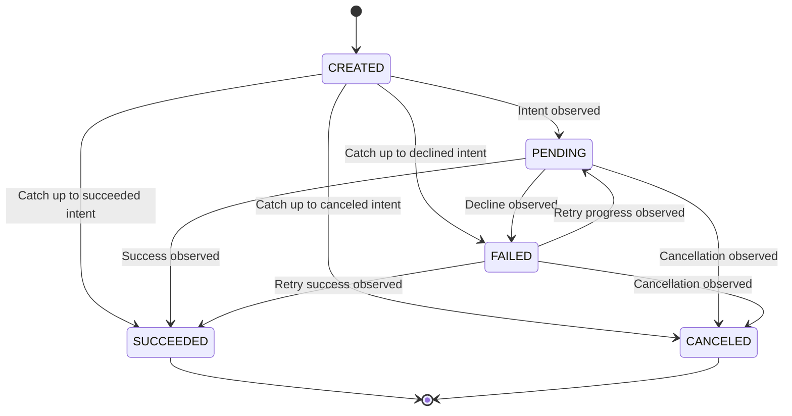
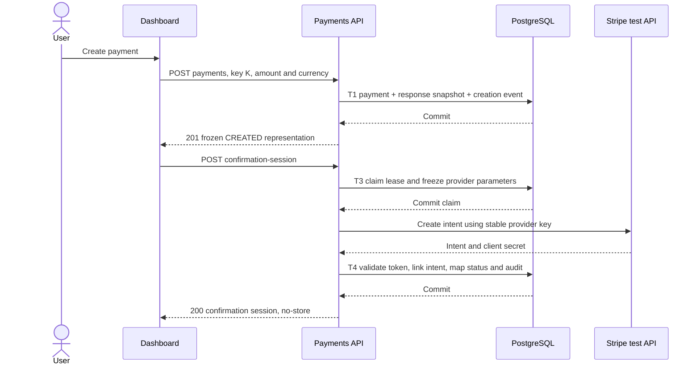
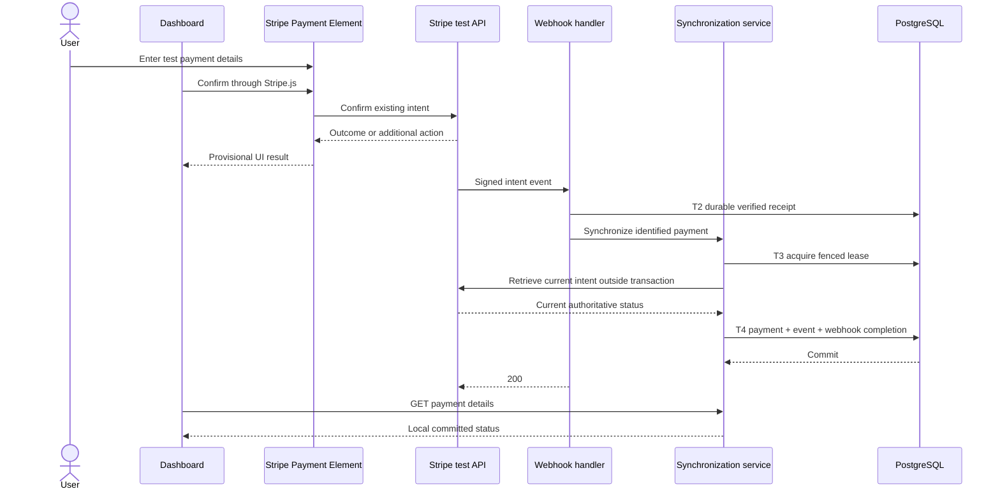

# Payment Lifecycle

## Local Status and Provider Authority

`Payment.status` is a local projection. Stripe's retrieved PaymentIntent is the authority for provider outcomes. A timeout describes the application's knowledge, not the result of a charge. An HTTP 201 only proves local creation, and a browser return URL only proves navigation.

| Local status | Meaning | Terminal? |
| --- | --- | --- |
| `CREATED` | Local payment committed; no authoritative provider observation applied yet | No |
| `PENDING` | Intent exists and awaits a method, confirmation, authentication or completion | No |
| `FAILED` | Latest observed attempt was declined and requires another payment method | No; retry the same intent |
| `SUCCEEDED` | Stripe confirms the intent succeeded | Yes |
| `CANCELED` | Stripe confirms cancellation | Yes |

Do not label a provider network error as `FAILED`. Provider creation errors stay in operational fields while local status remains unchanged. Retryable `FAILED` deliberately refines the suggested four-state model: a declined intent can later succeed. There is no local cancel operation in the MVP; `CANCELED` reflects provider-side cancellation or Stripe's own limit handling.

## Valid Transitions

| From | Allowed different target statuses |
| --- | --- |
| `CREATED` | `PENDING`, `FAILED`, `SUCCEEDED`, `CANCELED` |
| `PENDING` | `FAILED`, `SUCCEEDED`, `CANCELED` |
| `FAILED` | `PENDING`, `SUCCEEDED`, `CANCELED` |
| `SUCCEEDED` | None |
| `CANCELED` | None |

Same-state observations are accepted as no-ops, with no version increment or second financial event. All omitted transitions are rejected by the domain service. There is no API accepting a target status. Catch-up transitions from `CREATED` are necessary when provider creation succeeds but its local save fails and a later webhook observes a progressed intent.

## Normalized Provider Mapping

Apply this mapping only after verifying account/environment, `livemode=false`, amount, currency, metadata payment ID / instance ID / operation key, and the immutable linked provider ID.

The Stripe adapter under `src/integrations/stripe` translates raw provider fields into the neutral observation phase first. Payments projects that phase into its local state machine and validates the transition. Raw Stripe statuses remain audit/details data; domain services do not import SDK types or implement Stripe-specific status/error branches. See the [DI boundary](project-structure.md#dependency-injection-and-provider-replacement).

| Retrieved Stripe state | Additional condition | Normalized phase | Local target |
| --- | --- | --- | --- |
| `requires_payment_method` | No `last_payment_error` | `AWAITING_PAYMENT` | `PENDING` |
| `requires_payment_method` | Safe normalized decline/payment error exists | `DECLINED` | `FAILED` |
| `requires_confirmation` | Automatic-capture card workflow | `AWAITING_PAYMENT` | `PENDING` |
| `requires_action` | Automatic-capture card workflow | `ACTION_REQUIRED` | `PENDING` |
| `processing` | Automatic-capture card workflow | `PROCESSING` | `PENDING` |
| `succeeded` | Same verified amount/currency and expected intent | `SUCCEEDED` | `SUCCEEDED` |
| `canceled` | Same verified identity | `CANCELED` | `CANCELED` |
| `requires_capture` or unknown status | Unsupported configuration | `UNSUPPORTED` | Preserve status; `REVIEW_REQUIRED` |

Stripe's [lifecycle reference](https://docs.stripe.com/payments/paymentintents/lifecycle) explains that failed attempts can return to `requires_payment_method`. The local retryable failure label is this project's UI/domain decision. Do not retain a stale decline message when a later successful observation clears it. Preserve the earlier decline in audit history.

## Which Observations May Update Status

Only Payments' synchronization service may change financial status using:

1. A validated response to creating the intent with the frozen provider parameters.
2. A fresh retrieve of the intent triggered by an allowed, verified webhook.
3. A fresh retrieve triggered by the explicit synchronization/confirmation-session endpoints.

Subscribe to snapshot events `payment_intent.created`, `payment_intent.processing`, `payment_intent.requires_action`, `payment_intent.payment_failed`, `payment_intent.succeeded`, and `payment_intent.canceled`. Event payloads identify what to retrieve; they are not applied directly. Other valid test-mode event types are recorded and ignored. Do not use `charge.*` or browser confirmation results as a second competing status authority.

## Payment Creation Sequence

The API must commit the link before revealing the secret. If the provider call succeeds but the save fails, return an error, retain the durable operation key/deadline, and recover that same operation. Never create a replacement intent to make the UI proceed.

## Payment Confirmation Sequence

## Successful and Failed Flows

For success, create locally, obtain a session, confirm using Stripe's documented success test method, and observe `SUCCEEDED` after webhook processing or explicit synchronization. Display the provider ID and event timeline, but no secret.

For decline, enter Stripe's documented decline test method in the Payment Element. Display Stripe's safe form error immediately as provisional feedback, then synchronize. The verified current intent with a payment error maps to `FAILED`. A second form confirmation with a valid test method reuses the same intent and may transition `FAILED` through `PENDING` or directly to `SUCCEEDED`. Do not automatically retry a declined card, and do not create a new payment merely because the method was declined. The UI must distinguish “attempt declined; retry possible” from a terminal result.

For terminal cancellation, an operator can cancel a test intent in Stripe's dashboard as a supplemental demonstration. The application only observes it; no cancellation endpoint is planned.

## Provider Timeouts and Unknown Outcomes

| Failure point | Durable evidence | Recovery |
| --- | --- | --- |
| Before local commit | No accepted creation | Retry original application key |
| After local commit, before intent request | Payment and frozen create response | Request confirmation session |
| Intent create times out | Stable key, first-attempt time and frozen parameters | Retry same operation after backoff, within 23-hour cutoff |
| Intent response received, database save fails | Durable claim; provider may already have intent | Same-key recovery or correlated verified webhook |
| Confirmation succeeds, browser sees timeout | Existing intent; provider may have succeeded | Webhook or explicit sync retrieves current intent |
| Retrieve times out | Prior financial status preserved | Retry retrieve after backoff; never start another create |
| Crash during lease | Persisted token and expiry | New claim after expiry; stale owner is fenced out |
| Ambiguous unlinked create reaches cutoff | Unknown outcome | `REVIEW_REQUIRED`; no further create calls |

The provider retry budget and manual-review procedure are specified in [idempotency and webhooks](idempotency-and-webhooks.md). A create operation that failed definitively due to bad configuration is `BLOCKED`, not a declined payment. The developer fixes the underlying configuration and retries the exact frozen operation only when still safe; a parameter change requires proving the previous operation did not create an intent.

## Stale and Out-of-Order Events

Every handler acquires the same per-payment lease **before** fetching the current provider state. This serializes local observations without holding a database transaction during the fetch. Every apply checks its lease token and expiry. Event creation timestamps, event IDs, and HTTP arrival order do not determine status precedence.

For example, a delayed `payment_intent.payment_failed` event arriving after success causes a current retrieve, which still reports success. The handler records a no-change processed result. It cannot roll the payment back to `FAILED`. If a verified observation contradicts a committed terminal state, preserve the terminal status and atomically record `REVIEW_REQUIRED` instead of guessing.

Stripe can still change after a retrieve and before the local commit. The projection may temporarily lag; a subsequent webhook or explicit sync converges it. Leases prevent old application owners from overwriting newer commits, and terminal-state guards prevent regressions; they do not create an atomic transaction with Stripe. There is no claim of instantaneous cross-system consistency.

## Recovery Completion Criteria

A recovery is complete when the observed intent identity matches the local payment, the current provider state maps to an allowed local status, the corresponding event/receipt disposition is committed, and any retryable operational error is cleared. A same-state recovery updates `lastSyncedAt` and operational fields without another status transition. Unknown identity, expired idempotency protection, and unsupported statuses remain visible for manual review rather than being relabeled as financial failure.
