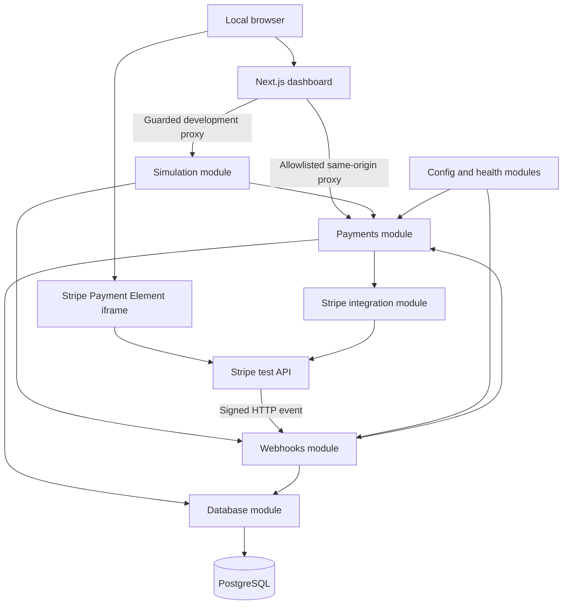

# System Overview

## Architecture and Scope

Use an npm-workspace monorepo with `apps/api`, `apps/web`, `infra`, and `docs`. The backend is one NestJS application using Express; the frontend is one Next.js App Router application. PostgreSQL is the baseline's only durable dependency besides Stripe. Avoid a monorepo framework, generic repository layer, message broker, CQRS, event sourcing, and a separate worker process.

Use `apps/api/src/modules` for business features, `src/shared` for reusable infrastructure and `src/integrations` for provider contracts/implementations. The frontend uses `apps/web/src/app`, page-local components and domain API hooks under `src/api/hooks`. The [project structure contract](project-structure.md) defines the complete layout and folder rules.

The MVP runs locally with one API process. Database constraints and fenced leases must nevertheless remain correct when integration tests run concurrent requests or multiple API processes. No correctness rule may depend on an in-memory mutex. Simulation fault switches may be in memory because they are explicitly single-process development tools.

Arrows indicate communication, not permission to import modules cyclically. The simulation replay helper sends an HTTP request to the fixed local webhook endpoint; it does not call a private status mutator.

## Local Container Runtime

The default local environment must run **the backend and PostgreSQL in Docker Compose from Stage 1**. Define the `api` and `db` services in `infra/compose.yaml`; a development Dockerfile for the API belongs in Stage 1. Stage 5 hardens the runtime images and adds/verifies the frontend container rather than postponing backend containerization until then.

| Component | Development/runtime contract |
| --- | --- |
| `api` | NestJS in a Node container; listen on all interfaces inside the container, publish port 3001 on host loopback only |
| `db` | PostgreSQL container, pinned image and named data volume; readiness check before API startup; optional local-tool access through loopback port 5432 |
| Next.js | Host development process on port 3000 initially; a `web` container is added and verified in Stage 5 |
| `redis`, if needed | Separate Compose service only after a concrete feature documents its purpose; use internal networking and a health check, without a host-published port by default |

Use the default Compose network. The API connects to PostgreSQL at `db:5432`, not container-local `localhost`. Host-run database tools/tests use their separate host connection settings; they must not reuse the container hostname. The host-run Next.js proxy reaches the published API at `http://localhost:3001`; when Next.js runs in Compose, its server-only backend origin is `http://api:3001`. The browser continues to use the local frontend origin and same-origin proxy, never Compose service names.

The API waits for database health at startup and retains its own liveness/readiness endpoints to detect subsequent database loss. Use source synchronization or development mounts with container-owned dependencies; changes to workspace manifests/lockfile require dependency refresh or image rebuild. Pin image versions, keep secrets out of images/build context, and preserve the database volume through normal restarts. Stripe CLI on the host forwards test events through the API's loopback-published port. Internal simulation self-requests may use the API container's own fixed loopback URL.

Redis is conditional, not required by any current payment invariant. Add it only when implementation identifies a concrete feature and documents its data, failure/recovery policy and verification needs; include it in Compose at that time. PostgreSQL constraints, idempotency records, event receipts and fenced leases remain the correctness mechanisms. Do not move payment consistency into Redis or add queues/workers solely because a Redis service is available.

## Backend Modules and Dependencies

| Module | Responsibilities and permitted dependencies |
| --- | --- |
| Config | Under `src/shared/config`; parse and validate environment values at startup; expose typed settings |
| Database | Under `src/shared/database`; own the Prisma connection and transaction adapter; depend on Config |
| Payment provider binding | Under `src/integrations`; export the `PAYMENT_PROVIDER` DI token bound to Stripe or the guarded fake |
| Stripe integration | Under `src/integrations/stripe`; implement the narrow port: create intent, retrieve intent, retrieve test event, verify signature; depend on Config |
| Payments | Under `src/modules/payments`; own creation/idempotency, list/detail/event queries, state machine, operation leases, provider synchronization and audit writes; depend on Database and the provider port |
| Webhooks | Under `src/modules/webhooks`; preserve/hand off raw bytes, persist receipts, deduplicate, and delegate current-state synchronization to Payments; depend on Database, provider verification, and Payments |
| Simulation | Under `src/modules/simulation`; fixed scenario orchestration and one-shot fault injection; depend on Payments/provider test helpers; conditionally registered only in development/test |
| Health | Under `src/modules/health`; liveness and database readiness; depend on Database |

Keep `PaymentEvent` persistence inside Payments. It does not need a standalone module. `PaymentProvider` is the only provider abstraction: a Stripe implementation plus a deterministic fake used in tests. Do not build a multi-provider framework. Expose one transaction-aware audit helper so a caller cannot commit a status without its event.

Inject services through NestJS constructors and use the runtime `PAYMENT_PROVIDER` symbol for the interface. The integration binding module chooses the implementation; feature services never construct/import a Stripe client or expose Stripe SDK types. Keep external SDK code and provider-specific error/verification logic inside the integration. A future replacement still requires reviewing Stripe-specific schema, API and UI contracts.

The pure transition function receives a current local status and a validated normalized provider observation. Controllers cannot accept arbitrary target statuses. The synchronization service owns all provider-driven changes, including observations from intent creation, webhooks, and explicit recovery requests.

## Provider Decision

Choose **Payment Intents with Stripe's Payment Element**, automatic confirmation and automatic capture. Compared with hosted Checkout, this requires a small embedded form but directly demonstrates a decline, a visible retry on the same intent, and confirmation outcomes without building a checkout/order domain. Hosted Checkout would reduce UI work but hide declines inside the hosted flow. No Checkout Sessions integration is included.

Payment fields are collected by Stripe's iframe. The backend returns a client secret only from the confirmation-session endpoint, never from listing, audit, logging, or creation-response storage. The frontend keeps it in component memory and never in URLs, local storage, analytics, or error reports. Follow the version-compatible [Stripe payment integration reference](https://docs.stripe.com/payments/payment-intents).

Limit the test account's payment-method configuration to cards and restrict the request to cards using the parameter supported by the pinned API version (the current API exposes `allowed_payment_method_types`). Set a configured local return URL. Exclude manual capture, saved cards, customers, wallets, subscriptions, redirects to arbitrary origins, and delayed payment methods. Validate unexpected provider statuses instead of treating them as success. See the [official creation API](https://docs.stripe.com/api/payment_intents/create).

## Request and Communication Flows

1. The dashboard generates a UUID idempotency key for a logical create action and preserves it through network retries. `POST /api/v1/payments` commits a local payment and frozen response without calling Stripe.
2. The dashboard requests a confirmation session. Payments claims a database lease, creates or recovers the intent outside the transaction, and commits the validated observation under the lease token.
3. Stripe.js confirms the intent through the Payment Element. The browser displays immediate errors as provisional UI feedback. It cannot set the local financial status.
4. A verified webhook or explicit `POST /api/v1/payments/:id/sync` retrieves the current intent and applies the state-machine projection. Ordinary GET requests never contact Stripe or mutate data.
5. The dashboard polls local details every two seconds while active, stopping after 60 seconds and offering explicit synchronization if still unresolved. Polling only reads the database; it is not a reconciliation worker.

The Next.js server proxies only documented API routes and methods to the fixed configured backend origin. It does not proxy a caller-supplied URL. Normal requests preserve `Idempotency-Key` and request correlation headers. Development proxy handlers add a server-only simulation token and validate same-origin browser requests before forwarding. Mark payment responses `Cache-Control: no-store`; do not introduce Next.js Cache Components.

Browser calls use the typed Axios client in `src/api` and TanStack Query hooks grouped by module under `src/api/hooks`. Keep component/form state local, configure read/mutation retries and bounded polling explicitly, and refetch current details after creation replay. Confirmation-session client secrets stay in component memory outside query/mutation caches. The [frontend structure and API policy](project-structure.md#http-and-querymutation-hooks) defines these boundaries; HTTP no-store and the transient query cache have different responsibilities.

## Error Handling Boundaries

| Boundary | Action |
| --- | --- |
| Invalid input | Reject before writes; consistent validation errors |
| Unique application key conflict | Roll back losing transaction, read winner, compare fingerprint and replay or conflict |
| Database deadlock/serialization conflict | Retry the entire short transaction at most three times with jitter; never repeat external calls as part of transaction retry |
| Provider timeout, connection failure, 429 or 5xx | Keep financial status; persist operational error and retry eligibility; never generate a new provider key |
| Provider parameter/configuration error | Persist `BLOCKED`, return a sanitized integration error; operator fixes configuration before recovery |
| Expired provider retry window or conflicting identity | Persist `REVIEW_REQUIRED`, require provider evidence before further action |
| Webhook transient failure | Persist retry information when possible and return 503; no acknowledgement based only on receipt |
| Unexpected exception | Roll back business writes, log correlation IDs, return a generic 500 |

All exceptions pass through a NestJS filter implementing the [API error schema](api-design.md). Logs include request ID, payment ID, webhook event ID, provider request ID, elapsed time, and a safe error code. Redact keys, authorization headers, signatures, client secrets, raw bodies, payment method details, and user-entered data. Operational errors and financial statuses are distinct fields.

## Configuration Contract

Stage 1 provides environment examples with placeholders and an opt-in generator for ignored local files; no real values belong in Git. Stage 3 requires explicit provider selection. Clean local setup chooses an explicitly enabled fake environment with random signing/bearer secrets and a distinct `simulator_fake` database; it needs no Stripe credentials. Existing ignored Stage 2 files are preserved and require the provider settings to be added. Stripe mode requires the test-only credentials/account/version below.

| Setting | Requirement |
| --- | --- |
| `NODE_ENV` | `development`, `test`, or `production`; production always disables simulation/fake mode |
| `DATABASE_URL` | PostgreSQL connection; `db:5432` from the API container, separate host-tool settings and development/test databases |
| `API_PORT` / `WEB_ORIGIN` | Default planned API port 3001; exact local frontend origin on port 3000 |
| `SIMULATOR_E2E` | Server-only opt-in used by the serial browser runner; changes the fixed loopback API port from 3001 to the reserved 3102, never derived from browser input |
| `API_INTERNAL_ORIGIN` | Server-only fixed backend URL: host Next.js uses `http://localhost:3001`, containerized Next.js uses `http://api:3001`; no caller override |
| `APP_INSTANCE_ID` | Stable environment UUID, persisted in Stripe metadata; must survive restarts |
| `PAYMENT_PROVIDER` | Required `stripe` or `fake`; fake allowed only in development/test with explicit simulation enablement and a database ending `_fake` or `_test` |
| `STRIPE_SECRET_KEY` | Server-only `sk_test_` key; reject live or unsupported key types at startup |
| `NEXT_PUBLIC_STRIPE_PUBLISHABLE_KEY` | `pk_test_` key for the browser; reject a live prefix |
| `STRIPE_WEBHOOK_SECRET` | Server-only `whsec_` secret for the chosen listener/endpoint |
| `STRIPE_ACCOUNT_ID` / `STRIPE_API_VERSION` | Expected account and exact stable `2026-11-18.endive`, matched to Stripe SDK 23.2.0 and the snapshot destination |
| `PAYMENT_RETURN_URL` | Exact `WEB_ORIGIN/payments/return`, no query/fragment; used during confirmation, never supplied by the API caller |
| `SIMULATION_ENABLED` / `SIMULATION_TOKEN` | False by default; opt-in plus server-only random bearer token |
| `TEST_WEBHOOK_SECRET` | Separate fake-provider/test signing secret; never accepted in Stripe mode |

In Stripe mode, validate the configured account using the API on startup; fail readiness on a mismatch. Inspect `livemode=false`, amount, currency, metadata and expected provider ID on every relevant observation. Metadata includes `payment_id`, `app_instance_id` and `operation_key`, with the last matching the immutable local provider operation key. Reject Connect account events. A test-key prefix check alone is not the complete safety boundary. Keep `APP_INSTANCE_ID` stable across normal restarts and rotate it when deliberately resetting the entire local database, so old provider objects cannot be mistaken for new demo data.

Use supported stable versions selected in Stage 1, pin dependencies and container image versions, and record the compatibility matrix in the root README. If Prisma 8 is chosen, use its version-specific documentation; do not copy older client methods or adapter configuration. Exact dependency versions are a setup deliverable, not an unresolved domain decision.

## Security and Deployment Boundary

The MVP has no accounts and no complex authentication. Run it on loopback; bind published Docker ports to `127.0.0.1`, use a strict frontend-origin policy, reject untrusted Host/Origin values on browser-facing proxies, and disable cross-origin credentialed requests. A public deployment would first require an access gate and is outside these stages. API and database containers may listen internally on all interfaces, but only loopback host publishing is permitted.

The webhook route is exempt from browser Origin checks and protected by Stripe signature verification and a 256 KiB body limit. Normal JSON requests have a 16 KiB limit. Apply modest request limits to writes and simulations; do not load test Stripe. Development routes require all three conditions: non-production environment, explicit enablement, and a constant-time checked bearer token. They are unregistered (404) in production, regardless of token or configuration. Never send the token to the browser or put it in a `NEXT_PUBLIC_` variable.

Preserve raw bytes at the Nest/Express boundary, following the [raw-body requirement](https://docs.nestjs.com/faq/raw-body). The existing app uses `bodyParser:false` and safe parser-error normalization; Stage 3 adds a route-specific Express raw Buffer parser before other JSON parsing, with a 256 KiB limit and no decompression. The selected adapter verifies that exact Buffer before envelope parsing. Other routes retain the 16 KiB JSON parser. This keeps signature verification ahead of business parsing and preserves the separate body limits. Secrets come from local environment files ignored by Git or CI secret configuration. Example files contain placeholders only. No raw card data or complete provider objects are stored.

## Operational Limits

Each provider call has a five-second timeout and no implicit SDK retries. A request makes at most one provider create or retrieve call, except that test-event replay explicitly retrieves an event and posts its deliveries. Leases last 30 seconds and commits require an unexpired matching token. Webhook handlers target completion within eight seconds; if a lease is busy or a call cannot finish, return 503 promptly.

Readiness checks PostgreSQL with a bounded query and returns 503 if unavailable. Liveness checks the process only. Health responses expose no connection strings or secret configuration. Application readiness does not pretend to prove future Stripe availability.
